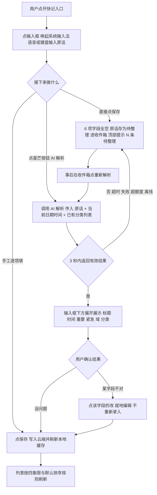
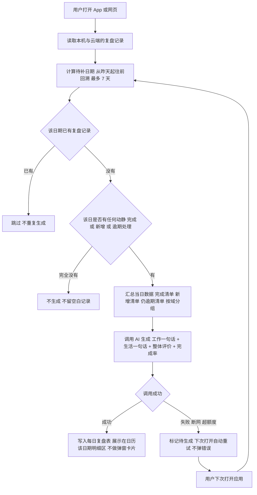
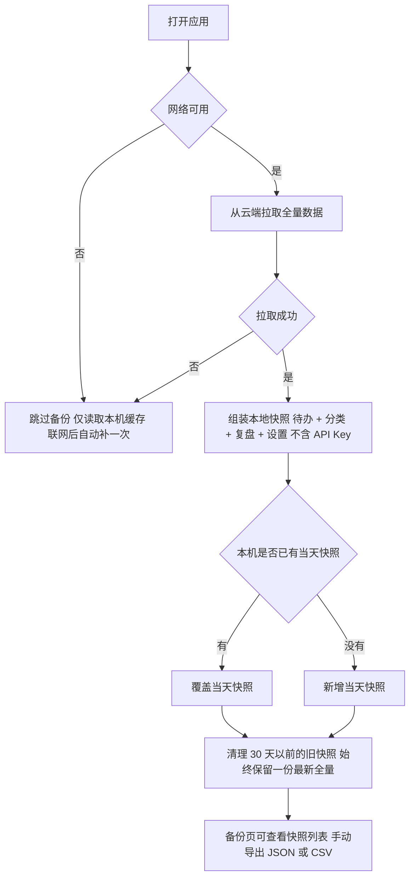
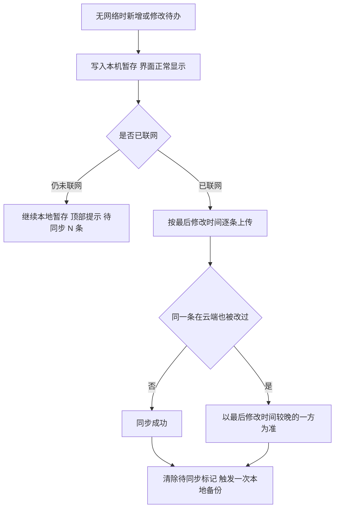

# 个人待办清单 · 产品需求文档（PRD）v2.8

---

## 0. 文档信息

| 项    | 内容                                        |
| ---- | ----------------------------------------- |
| 文档名称 | 个人待办清单 · 产品需求文档                           |
| 版本   | **v2.8**                                  |
| 日期   | 2026-10-13                                |
| 作者   | 许清楚（Xu）· 产品经理                             |
| 文档状态 | **需求已定稿（v2.6）；v2.7 = 与原型实现对齐；v2.8 = 用户拍板回写，需求有实质变更** |
| 上游文档 | 《待办清单-需求文档 v1.3》《多端同步与成本说明 v1.2》《安装与使用手册》**《实现盘点·前端原型》** |
| 实现对照 | **《实现盘点·前端原型》**（`docs/实现盘点-前端原型.md`）—— 本文件 §9.5「当前实现状态对照」的事实依据 |
| 适用范围 | 单人自用的跨端待办管理工具（电脑网页 + 安卓 APK）              |
| 阅读对象 | 架构师、开发、使用者本人                              |

**本版相对 v1.3 的主要变化**：v1.3 是"需求访谈记录"，本版是"可交付开发的需求规格"。  
变化在于——① 全部需求统一编号并分级；② 每条需求补上可验证的验收标准；  
③ 删除重复表述，收敛为单一事实来源；④ 技术/商务论证（云同步原理、资源点与成本测算）  
从正文中剥离，仅在附录留索引，指向 `多端同步与成本说明.md`。

> **v2.7 特别说明（读文档前先看这一句）**：本版**不改需求**，只把文档描述校准到当前真实代码。
> 目前代码只有一份**前端交互原型**（`prototype/index.html`，能点能看，但刷新就回到初始数据）。
> 凡是原型还没做到的，一律**保留 PRD 原文要求不动**，并在 **§9.5「当前实现状态对照」**里如实标注为
> 「原型占位 / 未实现」——**绝不会因为原型暂时做不到，就把产品的规矩改宽松**。

> **阅读约定**：本文面向编程零基础的读者。**每个专业术语首次出现时用大白话解释一次**，  
> 格式如「四象限（把事情按"重不重要 / 急不急"分成四格的方法）」。全部术语汇总见附录 B。

---

### 0.1 v2.1 变更记录（2026-10-10 用户拍板）

| # | 变更 | 影响范围 |
|---|------|----------|
| 1 | **废除"固定时间窗口"判定紧急**<br />不再用"3 天内到期"这类死数字。轻重缓急**只由颜色表达**，判定依据是你自己的说法（AI 提取）+ 手动一键改，时间不再参与象限计算 | FR-006（规则重写）、新增 8.5 配色规则 |
| 2 | **取消首页复盘卡片**<br />复盘不再以弹出卡片形式呈现，改为**融进日历**：点某一天，当天那句总结就在那儿 | FR-016 验收第 7 条、FR-017 呈现方式、5.2 流程图、8.1 架构图 |
| 3 | **改为底部三栏导航**<br />① 记一笔（默认首屏）② 日历 ③ 预留；取消原"顶部大 Tab 切域" | FR-007、第 8 章全章重写 |
| 4 | **工作/生活切换器改为三栏常驻**<br />三栏任意位置都能用一个显眼标志切域，不再依赖顶部 Tab | FR-007、新增 FR-021 |
| 5 | **新增日历视图为 P0**<br />按月看，每天显示完成/未完成，按轻重缓急着色，逾期有提示 | 新增 FR-022 |
| 6 | **新增自定义背景图为 P1**<br />工作域、生活域可各设一张背景图 | 新增 FR-111 |
| 7 | Q1、Q5 已由用户回答并关闭；新增 Q11（第三栏放什么）、Q12（生活域主色） | 第 10 章 |
| 8 | **其余待确认问题保留**，一律**按推荐默认值执行**，不再阻塞开发 | 第 10 章 |

### 0.2 v2.2 变更记录（2026-10-10 界面评审后拍板）

> 本版只改界面相关的三处，需求池条数不变（P0 22 / P1 11 / P2 5）。

| # | 变更 | 影响范围 |
|---|------|----------|
| 1 | **悬浮 + 号只在第 ② 栏可见**<br />① 栏本身有输入框、③ 栏是设置区用不上，都不再放悬浮快记 | FR-011 验收第 1 条重写 |
| 2 | **悬浮 + 号样式定为「白色圆形 + 加粗蓝色加号 + 投影，无描边」**<br />与第 ① 栏蓝底白图标的「收件箱」漂浮按钮颜色相反，一眼可分 | FR-011 新增验收第 6 条 |
| 3 | **收件箱入口改为第 ① 栏右下角圆形漂浮按钮**<br />原列表底部文字入口取消，按钮右上角挂红色「待整理」条数角标 | 8.2 设计原则新增第 6 条 |

### 0.3 v2.3 变更记录（2026-10-10 界面评审第二轮）

> **一句话**：快记界面的麦克风按钮改为 **【AI 解析】星芒按钮**（语音改走系统输入法自带麦克风），
> 保存路径从「提交即解析」改为**三条并列路径**，入箱判定改为看**字段是否全空**。

| # | 变更 | 影响范围 |
|---|------|----------|
| 1 | **去掉专门的麦克风按钮**<br />语音输入改走系统输入法自带麦克风（点输入框即唤起键盘）；原麦克风位置改为**【AI 解析】星芒按钮**，图标放大到 22px | FR-012 重写 |
| 2 | **解析由「提交即自动」改为「点按钮触发」**<br />用户说完后有 3 条并列路径：① 直接【保存】② 点【AI 解析】看结果再【保存】③ 手工逐项填完再【保存】 | FR-001 需求描述与验收 |
| 3 | **入箱判定改为看字段是否全空**<br />点【保存】时，若下方 6 项（标题 / 完成时间 / 重要 / 紧急 / 归属域 / 分类）**全部为空**，或【AI 解析】失败（超时 / 超额度 / 离线）→ 存为「待整理」进收件箱；**只要手工填了任意一项就正常入库** | FR-003 重写、FR-010 第 3 条 |

### 0.4 v2.4 变更记录（2026-10-10 界面评审第三轮）

> **一句话**：每日复盘是**全天跨域合并的一条**，跟当前在哪个域无关 —— 切工作域或生活域，看到的是同一条复盘，
> 与「日历明细只显示当前域事项」的规则**并存不冲突**。

| # | 变更 | 影响范围 |
|---|------|----------|
| 1 | **复盘改为全天合并、与域无关**<br />AI 同时读取工作 + 生活两边当天数据，生成**一条**复盘（含工作一句 / 生活一句 / 整体评价 / 完成率）；无论从工作域还是生活域点开同一天，看到的复盘**完全相同** | FR-007 第 4 条、FR-016、FR-017 |
| 2 | **明确「域隔离」与「复盘合并」的边界**<br />日历/明细里的**事项列表**只显示当前域（两域不混）；**当天复盘**是唯一例外，全天合并、跨域共享 | FR-022 第 7 条 |
| 3 | 复盘卡片的呈现顺序：置于当天明细**列表之上**，作为「这一天的总结」先出现 | 8.3 设计原则 |

### 0.5 v2.5 变更记录（2026-10-10 界面评审第四轮）

> **一句话**：既然复盘是工作 + 生活**合成的一句话**，那它就该是**一个中性灰色的框**（不是两个，
> 也不跟域变色）；生成后**锁定不改**，要更新得用户自己点【重新生成】；
> 日历上「这天有总结」改用**灰底色**表示，把圆点让给逾期。

| # | 变更 | 影响范围 |
|---|------|----------|
| 1 | **复盘从「两句 + 两个色块」改为「一句话 + 一个中性灰框」**<br />工作和生活的事揉进同一句话，不分成工作框 / 生活框；框用中性灰（#F1F5F9），**不随当前域变色** | FR-017 验收第 1、4 条重写 |
| 2 | **复盘生成后自动锁定，可手动重新生成**<br />当天后来补记、补完成的事**不会改写**已生成的复盘（保留旧的）；卡片上显示**生成时间**并提供**【重新生成】按钮**，用户点它才重算 | FR-016 新增验收第 10、11 条 |
| 3 | **日历「这天有总结」改用灰底色**<br />不再占用圆点 —— 圆点让给逾期红点，两者可同时出现、互不抢 | FR-016 验收第 8 条重写、8.3 设计原则 |

### 0.6 v2.6 变更记录（2026-10-11 交互逻辑与字段结构确认）

> **一句话**：把"点哪里"和"谁生成"这两件事定死 —— 点条目进详情、点小圆圈才算完成；
> 备注是你说的原话，其余字段都是 AI 从原话里提取的；顺手把两个页面里不一致的字段结构统一。

| # | 变更 | 影响范围 |
|---|------|----------|
| 1 | **明确列表点击的两套手势**<br />在列表（第 ① 栏今日/逾期、第 ② 栏某天明细）里：**点条目任意位置 → 进「待办详情」页**；**只有点最左边的小圆圈 → 才标记完成 / 取消完成，且不跳转详情**。两者互不误触 | FR-005 新增验收第 6 条、8.2 / 8.3 设计原则 |
| 2 | **明确每个字段"谁生成"**<br />**备注 = 你输入的原始话**（逐字保留，AI 不改写）；**标题 / 完成时间 / 重要 / 紧急 / 归属域 / 分类 = AI 从原话提取生成**，每一项都能手动改 | 新增 FR-023、6.2 字段说明 |
| 3 | **未解析 / 直接入箱的记录长什么样**<br />没点解析就保存、解析失败、或滞留收件箱时：**上面 6 项全空**，只有「备注」留着原话；列表里不做"无标题"空壳，直接用**原话前 12 字**当占位标题显示 | 新增 FR-023 验收、6.2 字段说明 |
| 4 | **字段结构全局统一（归属 ≠ 分类）**<br />「归属」= 工作 / 生活，只能二选一；「分类」= 该域下的自定义标签（如"报表材料"）。**两者永远是两个独立字段、两行，不得合并成一行**（此前记一笔页把"工作 · 报表材料"塞在一格里，与详情页不一致，已改齐） | FR-002 新增验收第 6 条、6.2 字段说明 |
| 5 | **收件箱入口：两个域各有一个**<br />收件箱是**跨域暂存区**，既不归工作也不归生活 —— 所以**生活域同样在右下角放一个漂浮按钮**，与工作域入口**进的是同一个收件箱**；按钮**底色随域变**（工作蓝 / 生活珊瑚），「待整理」红角标不变 | FR-010 验收第 3 条重写、8.2 第 6 条、8.6 视觉表 |
| 6 | **第 ② 栏悬浮快记加号收细**<br />悬浮 + 号的**笔画描边由 5px 收到 4px**；按钮本身仍是「白色圆形 + 蓝色加号 + 投影、外圈无描边」 | FR-011 验收第 6 条 |
| 7 | **象限色条加粗，让轻重缓急更抓眼**<br />原来 4px 细线太弱，扫视时抓不住；改为 **8px 宽 × 42px 高、圆角 4 的圆头胶囊**。**不新增元素、不给条目卡片上淡色底** —— 四色底纹会让列表变花，与"不要杂乱"冲突 | 8.5 颜色语义新增第 7 条、FR-006 验收第 2 条 |
| 8 | **A1 与 A3 条目间距统一为 10**<br />两屏对齐；生活域的"宽松感"改由**更大的卡片内边距（18）与更圆的圆角（16）**表达，**不再靠拉大条目间距** | 8.6 视觉区分表 |
| 9 | **收件箱一屏两套配色；日历补生活域月视图**<br />A4 **不做第二屏**，但**从哪个域进就套哪个域的配色**（内容完全相同）；日历新增**生活域月视图一屏**（暖珊瑚 + 暖米白 + 生活域事项，与工作域是两套数据） | 8.7 页面清单、FR-010/022 |
| 10 | **日历格改用符号，逾期改红下划线**<br />完成 = 实心圆 **●**、未完成 = 空心圆 **○**（**不用"3 完 2 未"这类汉字**）；**"有逾期"由红点改为红色下划线**，与"有总结"的灰底色彻底区分 | 8.3 第 1 条、FR-022 验收第 2 条 |
| 11 | **取消登录页 B4，改为在「我的」里配置云服务**<br />**不做手机号登录**；云端能力靠用户在第 ③ 栏**自己填云服务配置**开启，**不配置 = 纯本地记录，App 完整可用**。代价：没有账号即没有找回通道，因此**必须支持配置码导出 / 导入** | FR-014 重写、FR-013 新增前置条件、8.4、8.7、9.1、附录 A |
| 12 | **新增「云服务配置」页 C4，支持导入配置**<br />四个输入框（服务地址 / 环境 ID / 访问密钥 / 同步口令）+【测试连接】+【导入配置码】+【导出配置码】。**没有导入能力的话换设备必然手抄长串，等于不可行** | FR-014 第 4 条、8.7 新增第 8 行 |
| 13 | **C1 栏目重排为三组**<br />**配置**（云服务 / AI 服务 / 备份 / 回收站）、**偏好**（背景图 / 分类）、**其他**（更新 / 断开云）；AI 服务配置从原「偏好与配置」移入「配置」<br />　　**⚠️ v2.7 注：本条已被 #17 取代**，不再作为口径（#17 是更晚拍板、且原型就是按 #17 实现的）。保留原文以便回溯，实际分组见 #17 与 §8.4 | 8.4、说明-C1 |
| 14 | **日历概况改回「数字 + 圈」**<br />**保留数字**，只把汉字换成圈 —— `3●2○`（**不是**把数字删掉画 3 个实心圈）；同时生活域圆角再加大（卡片 16→20、输入框 18→24），与工作域拉开差异 | 8.3 第 1 条、FR-022 第 2 条、8.6 |
| 15 | **三处观感微调**<br />① 生活域再"圆滚滚"一档：卡片圆角 20→**24**、内边距 18→**20**，输入框圆角 24→**28**<br />② 日历的圈改小：**数字 9px、圈 6px**（圈比数字小一号，不抢数字）<br />③ 第 ① 栏输入框加大：内边距 12→**18**、占位字号 15→**17**、圆角 14→**18** | 8.2 新增第 11 条、8.3、8.6、FR-022 |
| 16 | **第 ③ 栏「我的」取消域之分**<br />设置是全局的，不该跟着域变色。整栏改为**中性配色**（不冷蓝也不暖珊瑚）；顶部「工作 / 生活」药丸改为**灰色静态态**，左右两半各占一边、均不可点 | 8.1 第 2 条、8.4、FR-007 第 5 条、8.7 |
| 17 | **「我的」收敛入口 + 补齐反馈与二级页**<br />① **云服务只留一个入口**：删掉【配置】里的云服务配置与【其他】里的"去配置云服务"，统一走**顶部云同步卡片**<br />② **本地自动备份不给入口**（自动执行）<br />③ **导出备份 / 检查更新点完弹窗**告知导出位置、是否最新<br />④ **回收站、自定义背景图补独立页面**<br />⑤ 顺带把分组理顺为：配置 / 数据与备份 / 偏好 / 其他<br />　　**✅ v2.7 确认：本条是「我的」分组的唯一口径**（与 §8.4 正文一致，原型 `meHTML()` 也是按这四组实现的）；#13 的旧三组已被取代 | 8.4、8.7 新增第 9、10 行、FR-015/018/019 |
| 18 | **标完成 = 变灰 + 沉底，不消失（全局统一）**<br />此前首页把已完成项**过滤掉了**（等于消失），与日历明细行为不一致。统一为：**任何列表里标完成后条目都留在原处**，整条转灰（含象限色条）、标题加删除线，**排到当日最下方**；日历格 `3●2○` 与首页「逾期 N 件」**实时跟着变** | FR-005 第 3 条、FR-006 第 4 条、FR-022 第 8 条 |
| 19 | **取消悬浮 + 号 + 修两个逻辑 bug**<br />① **手机端彻底取消悬浮 + 号**（原 v2.2 定的"仅第 ② 栏可见"作废）：点底部「记一笔」即自动聚焦，作用相同且少一个控件、少一处遮挡<br />② **逾期项只挂它原定那天**，不再跟着出现在未来每一天<br />③ **记录真实完成时刻**，补做旧事后翻回原定那天能看到"其实是今天才做完的" | FR-011 重写、FR-022 第 4 条、FR-005 第 3 条、8.6 |
| 20 | **四项交互补齐**<br />① **新增 FR-024 循环安排**：第 ② 栏固定入口，支持每周 / 每月 / 每隔 N 天，属性与普通待办一致，创建后即排入日历<br />② **新建分类可自定义姓名 / 颜色 / 符号**<br />③ **A2 与详情页字段整行可点编辑**，删掉「改」字；并修掉"点面板内部会误退出聚焦"的 bug<br />④ **收件箱**：可点圆圈直接标完成（计入当天）、详情页加【✦ 解析这一条】、【置顶】改【保存】、**取消两个分组全部平铺** | 新增 FR-024、FR-008 第 2 条、FR-002 第 5b 条、FR-004 第 5、6 条 |
| 21 | **修字段显示 bug + 两处体验升级**<br />① **修 bug**：收件箱里填了「重要 / 紧急」却不显示 —— 根因是拿"标题有没有值"代替"字段填没填"来判断显隐。**重要 / 紧急必须用三态**（`null` = 没填过，`true/false` = 用户的选择），不得用默认 `false` 冒充"没填"<br />② **分类符号改为具象物件**：从 8 个几何图形换成 **24 个具象 emoji**（💼 工作 / 📝 记录 / 🖊️ 笔 / 🧾 票据 / 🏠 家 / 🛒 采购 / 🚗 车 …），一眼看出这堆是什么事<br />③ **选完成时间改为弹月历**：直接点日期，可左右翻月、可填时间、可清除，不再只有"今天 / 明天 / 下周"三个选项<br />④ **具体时间用下拉选，不手打**（v2.6）<br />⑤ **分类管理删掉「改」字**：整行可点即编辑（改名 / 改色 / 改符号 / 删除）；**颜色作用在"淡色底衬 + 左侧 3px 竖条"上**（emoji 是彩色字形、改不动颜色，强行染会很突兀）；**选分类的列表里必须带颜色和符号**，不能只有文字 | FR-002 新增第 5c 条、FR-008 第 2 条、6.2 todos 字段说明 |
| 22 | **分类可拖动排序 + 时间控件细化 + 修"跳回顶部"bug**<br />① **分类支持长按拖动排序**（长按约 0.4 秒进入拖动态，右侧给 ⋮⋮ 手柄提示），顺序**在选择分类时同样体现**；删除分类**不删其下待办**，改为未分类<br />② **时间下拉细化**：小时 / 分钟的空值统一显示为 **「—」**；**分钟改 5 分钟一档**（00/05/…/55）；**只显示数字，不加"点""分"**；两个框之间加**冒号**；宽度固定，绝不超出弹窗<br />③ **修 bug：首页勾选完成 → 页面弹回顶部** —— 根因是每次重渲染都把 `scrollTop` 置 0。**原地更新类操作（勾选完成 / 改字段 / 保存 / 恢复等）必须保留滚动位置**，只有切换栏目、进入或退出二级页才回顶部 | FR-008 新增第 4 条、FR-002 新增第 5e 条 |


### 0.7 v2.7 变更记录（2026-10-13 文档与前端实现对齐）

> **一句话**：本轮**不改需求**，只做一件事 —— **把文档描述校准到当前真实代码**，
> 并**首次引入「实现状态」这个维度**（§9.5），让"要求是什么"和"现在做到哪一步"一页对照、不再混为一谈。

**对齐口径（本轮的拍板原则，先看这张表再看后面的改动）**

| 原则 | 适用情形 | 处置方式 |
|---|------|------|
| **A** | 原型偷懒 / 占位 / 技术受限 | **产品规则一律不动**，只在文档里如实标注「当前原型未实现」。例：正则假解析、"明天"算错、零持久化、无自动生成复盘、无真实云同步、无 APK |
| **B** | 实现更合理，且属于用户**更晚**拍板的口径 | **改 PRD 与实现对齐**。例：删除分类 → 未分类；「我的」分组以 #17 为准 |
| **C** | PRD **自身前后矛盾** | **收敛为单一事实来源**（FR-008 ↔ 6.3 / Q9、8.4 ↔ 8.7、#13 ↔ #17） |
| **D** | 原型内部自相矛盾、且 PRD 没说清 | **不擅自改产品规则**，列为待拍板项 **D-xx**（见 §9.5.3），并给出推荐值与理由 |

| # | 变更 | 影响范围 |
|---|------|----------|
| 1 | **版本与文件名修正**<br />文件名 `PRD-待办清单-v2.0.md` → **`PRD-待办清单-v2.7.md`**；文首标题与 §0 文档信息表的版本改为 **v2.7**、日期改为 **2026-10-13**（此前文件名写 v2.0、正文写 v2.6，长期不一致） | 文件名、文首标题、§0 |
| 2 | **上游文档补《实现盘点·前端原型》**<br />并新增「实现对照」一行，指明它是 §9.5 的事实依据 | §0 文档信息表、附录 C |
| 3 | **新增 §9.5「当前实现状态对照（v2.7 新增）」**<br />含三块：**9.5.1** 当前进度与原型边界（大白话）、**9.5.2** 全部 FR 的实现状态矩阵（✅ 已实现 / ⚠️ 原型占位 / ❌ 未实现）、**9.5.3** 与 PRD 的偏差清单（D-01 ~ D-25，含推荐处置） | 新增章节 |
| 4 | **FR-008 验收第 4 条按「未分类」改齐**<br />删除分类后其下待办**改为未分类**（不进收件箱）—— 与 §6.3 及 v2.6 变更 #22① 一致；原文「自动归入收件箱」属过时表述 | FR-008 验收 4 |
| 5 | **第 10 章 Q9 按「未分类」改齐**<br />推荐默认值由「归入收件箱」改为「**改为未分类**（待办本身不删除、不移动）」 | Q9 |
| 6 | **8.7 页面清单删除「本地自动备份」入口**<br />原列表与 8.4「刻意不给入口」矛盾；同时给 10 个页面各补一列「实现状态」 | 8.7 |
| 7 | **「我的」分组按 v2.6 变更 #17 收敛**<br />以 #17（配置 / 数据与备份 / 偏好 / 其他）为唯一口径；#13 的旧分组（配置 / 偏好 / 其他 三组）标注为「**已被 #17 取代**」 | 0.6 #13、#17、8.4 |
| 8 | **P0 条数计数更正：23 → 24**<br />FR-023、FR-024 是 v2.6 新增，§4.0 的计数当时未同步；以 §4.1 表格实际条目为准（24 + 11 + 5 = **40** 条） | §4.0、§4.1、§9.1 |
| 9 | **存在偏差的 FR 条目就地补「当前实现状态」一句**<br />读需求时就知道现在做到哪一步；**不改写需求正文** | §4.1、§4.2 |
| 10 | **§9.1 MVP 进度说明**<br />补上 24 条 P0 的 ✅ / ⚠️ / ❌ 统计，并明确写出 **MVP 尚未完成** | §9.1 |
| 11 | **《多端同步与成本说明》加状态注记**<br />文首注明：截至 PRD v2.7 / 2026-10-13，文中的云同步方案**尚未在前端原型中实现** | `docs/多端同步与成本说明.md` |
| 12 | **遗留待用户拍板项 D-01 ~ D-25**<br />每条给出推荐处置与理由，等拍板后再回写 PRD | §9.5.3 |

---

### 0.8 v2.8 变更记录（2026-10-13 用户拍板回写）

> **一句话**：把 v2.7 留下的 12 项待拍板项 **D-01 ~ D-25** 一次拍完，连同衍生问题一并回写。
> **本版改的是需求本身**（v2.7 明确"不改需求"，v2.8 不適用），共 **7 处实质变更**。
> 拍板过程与完整对照表见 `docs/里程碑拆解与耦合分析.md` §7。

| # | 变更 | 影响范围 |
|---|------|----------|
| 1 | **排序改为「逾期优先」**<br />顺序：置顶 → **逾期组（组内再按象限 ①②③④ 排）** → 正常四象限 ①>②>③>④ → 已完成沉底。<br />原写法是"象限内再分逾期"，现改为**逾期整体提前** | FR-006 验收 4 |
| 2 | **入箱判定改为「4 项全填才出箱」**<br />判定只看**标题 / 完成时间 / 轻重缓急 / 归属域** 4 项，缺任一项即进收件箱。<br />**分类是选填项、不参与判定** —— 不填就是「未分类」，**不算空缺**，不会因此被扣在收件箱。<br />原写法"填任一项即入库"作废 | FR-003 描述与验收 6、FR-010 验收 3 |
| 3 | **重要 / 紧急 合并为「轻重缓急」四象限选择器**<br />面板与详情页不再有"重要""紧急"两行，改为**一个四象限选择器**，**点一次即选中**。<br />**存储层仍是 `是否重要` / `是否紧急` 两个三态字段不变**，只有 UI 合并呈现 —— 排序、象限推导、复盘统计的代码都不受影响 | FR-002 验收 1 / 3 / 5d / 6、6.2、8.2 |
| 4 | **列表不显示象限文字，选择器内部必须显示**<br />列表与日历**只用颜色**（不显示"马上做"这类文字）；但**四象限选择器内部必须显示文字**，否则用户不知道自己在选什么 —— 这是对"不显示文字标签"的**唯一例外** | FR-006 验收 2 |
| 5 | **首屏取消折叠，改为可下滑**<br />不再"≤ 10 条其余折叠"。放不下的当日条目直接下滑查看 | FR-010 验收 2、8.2 第 3 条 |
| 6 | **人工决定不被覆盖（含批量）**<br />手动填过的字段，重新解析**不得覆盖**；收件箱的「一键全部重新解析」**同理**，逐字段判断是否被人工改过，改过的跳过 | FR-002 验收 4、FR-004、6.2 |
| 7 | **其余拍板项**<br />① 完成时刻取**真实系统时间**；② 日历**真实日期 + 可切月**；③ 补全 `创建时间 / 最后修改时间 / 来源 / 人工决定标记 / 解析状态` 字段；④ A2「归属」**只改这一条的归属，不切全局域**；⑤ 删除「更远日期 · 见收件箱」文案；⑥ 新增 **FR-025 本地数据存储（P0）** | FR-005、FR-022、6.2、FR-010、8.2、§4.1 |
| 8 | **N-02 四象限「未判断」态**：选择器默认显示灰色 **「— 未判断 —」**，选中某一象限后变对应颜色并写入 `是否重要` / `是否紧急` | FR-002 验收 5d |

---

## 1. 产品概述

### 1.1 一句话定位

**一个"张嘴说一句话就能记下、打开就知道先干什么"的个人待办清单，工作与生活分开管理，晚上自动给你一句人话总结。**

### 1.2 问题定义

使用者面临 6 个已确认痛点，其根因可收敛为两条：**入口不统一**（记录散落在多处）与  
**事后无法排序**（记下来也看不出轻重缓急）。

| 编号 | 痛点        | 表现             |
| -- | --------- | -------------- |
| P1 | 事项量大且杂    | 脑子里装不下，顾此失彼    |
| P2 | 记不住       | 依赖记忆必然遗漏       |
| P3 | 判断不了轻重缓急  | 时间花在不重要的事上     |
| P4 | 工作与生活边界模糊 | 下班仍被工作事项干扰     |
| P5 | 记录分散      | 找不到、不敢删、不敢确认完成 |
| P6 | 记录门槛高     | 想记的时候嫌麻烦，转头就忘  |

**因此，本产品的第一优先级不是"功能多"，而是"记录足够快、查看足够清晰"。**

### 1.3 产品目标（可衡量）

| 编号 | 目标          | 衡量指标                      | 目标值                        |
| -- | ----------- | ------------------------- | -------------------------- |
| G1 | 统一入口，消灭记录分散 | 试用一周后"把事记在别处"的次数          | **0 次**（用户自评）              |
| G2 | 零负担记录       | 从"想到"到"保存成功"的耗时           | 语音路径 **≤ 8 秒**；打字路径 ≤ 15 秒 |
| G3 | 一屏看懂        | 打开首页后能说出"今天最该做的三件事"所需时间   | **≤ 3 秒**                  |
| G4 | 解析可信        | 20 条真实口语样本中，时间字段抽取正确率     | **≥ 90%**                  |
| G5 | 不越权判断       | 用户未表达重要程度时 AI 擅自给出"重要"的次数 | **0 次**（硬性红线）              |
| G5b | 颜色可信 | 抽样 10 条，用户**仅凭颜色**判断轻重缓急的正确率 | **≥ 9 次**（颜色语义必须直觉可读） |
| G6 | 复盘有共鸣       | 10 次每日复盘中用户认为"说得像我"的次数    | **≥ 8 次**                  |
| G7 | 数据永远能带走     | 任意时刻本机是否存在可用的全量数据副本       | **是**（每次打开后自动成立）           |

### 1.4 非目标（明确不做）

| 编号  | 不做的事                  | 原因                           |
| --- | --------------------- | ---------------------------- |
| NG1 | 多人协作、共享清单、团队权限、指派他人   | 单人自用，协作会抬高复杂度                |
| NG2 | iOS 应用、上任何应用市场        | 用户只用安卓；上架需年费/审核/软著，无收益       |
| NG3 | 真正的"零点定时生成"（服务端定时任务）  | 当前云服务无云函数；且"打开时生成"对用户体验等价    |
| NG4 | 复杂项目管理（甘特图、依赖、工时统计）   | 与"8 秒记完"的核心价值冲突              |
| NG5 | 邮件 / 微信 / 日历的双向集成     | 数据出入口越多，越破坏"统一入口"目标          |
| NG6 | 系统级推送通知（到期弹窗）         | 网页通知易被浏览器拦截、安卓需保活；改用"逾期专区"高亮 |
| NG7 | 多设备实时冲突自动合并（专业级 CRDT） | 单人使用场景极少冲突，用"最后修改时间为准"足够     |

---

## 2. 用户画像与使用场景

### 2.1 用户画像

| 项      | 描述                                          |
| ------ | ------------------------------------------- |
| 使用者    | **本人 1 人**，非团队                              |
| 身份     | 职场人士，同时承担工作任务与家庭生活事务                        |
| 技术背景   | **编程零基础**。要求"开箱即用"；任何需要敲命令、装环境、配服务器的操作都不可接受 |
| 设备     | 手机：**安卓**（仅此一个平台）；电脑：浏览器                    |
| 核心诉求排序 | ① 记得快 ② 看得清 ③ 工作生活分开 ④ 数据能带走                |
| 使用强度预估 | 每天新增约 10~~20 条，同时活跃待办约 50~~200 条            |

### 2.2 典型使用场景

| 编号 | 场景           | 设备     | 行为                  | 关键需求      |
| -- | ------------ | ------ | ------------------- | --------- |
| S1 | 开会中临时想到一件事   | 手机 APK | 打开 → 说一句 → 保存，先不分类  | 记录快、无必填项  |
| S2 | 走路/通勤时想到     | 手机 APK | 语音说一句，先进收件箱         | 语音入口、离线可用 |
| S3 | 早上到公司开工前     | 电脑网页   | 看今天要做的事，四象限已排好      | 首页排序、一屏看懂 |
| S4 | 领导临时派活       | 手机/电脑  | 加一条 + 说"今天下班前"      | 时间口语识别    |
| S5 | 周末安排生活琐事     | 手机 APK | 切到"生活"域，加缴费、采购、家人生日 | 双域隔离、分类   |
| S6 | 晚上收工         | 手机/电脑  | 看今日复盘那句话            | 自动复盘、有人情味 |
| S7 | 晚上回顾         | 电脑网页   | 看哪些没做完，挪到明天         | 逾期专区、批量改期 |
| S8 | 换手机 / 担心数据丢失 | 手机     | 打开 App 自动落一份数据到本机   | 本地自动备份    |
| S9 | 想换 AI 服务商    | 任意     | 设置页改三个框 → 测试连接 → 保存 | 可迁移性      |
| 界面骨架 | **底部三栏**：① 记一笔（默认首屏）② 日历 ③ 我的；顶部不再放域切换 Tab |
| 域切换 | 显眼切换器在三栏**同位置常驻**，切栏不重置当前域 |
| 复盘呈现 | **不做卡片/弹窗**，展示在日历该日期的明细区 |
| 轻重缓急载体 | **只用颜色**（红/蓝/橙/灰），不显示文字标签；颜色通过下表判定，与时间无关 |
| 自定义背景图 | 支持，工作域/生活域各一张（FR-111），需加遮罩保证文字可读 |
| 待确认问题处置 | 除已拍板的 Q1/Q5，其余一律**按推荐默认值执行**，保留记录不阻塞开发 |

---

## 3. 核心用户故事

| 编号    | 用户故事                                                                       | 覆盖环节     |
| ----- | -------------------------------------------------------------------------- | -------- |
| US-1  | 作为**一个事情很多的人**，我希望**张嘴说一句话就能记下一条待办、不用填任何表单**，以便**在想到它的 8 秒内就记下来，不再依赖记忆**   | 记录       |
| US-2  | 作为**一个经常被打断的人**，我希望**即使断网或 AI 挂了也能把话原样存下来并事后补整理**，以便**任何情况下都不会出现"记不进去"**   | 记录（降级）   |
| US-3  | 作为**一个要分清轻重缓急的人**，我希望**打开就能看到按四象限排好序的今日清单**，以便**3 秒内知道今天最该做哪三件事**          | 查看 / 优先级 |
| US-4  | 作为**一个不想被工作打扰生活的人**，我希望**工作和生活是两个视觉风格完全不同的独立区域**，以便**一眼就知道现在在操心哪一边**       | 分类 / 分域  |
| US-5  | 作为**一个记性不好的人**，我希望**逾期事项被单独高亮聚在一起、不清掉就一直出现**，以便**不会无声无息地漏掉一件事**            | 防漏记      |
| US-6  | 作为**一个想复盘的人**，我希望**打开应用时自动生成"上一天"的一句话总结和评价**，以便**不用记得去点按钮也能每天回顾**          | 复盘       |
| US-7  | 作为**一个讨厌官样文章的人**，我希望**复盘读起来像朋友随口聊一句、俏皮但说实话**，以便**我真的愿意看它，而不是划掉**           | 复盘（语气）   |
| US-8  | 作为**一个担心数据被锁死的人**，我希望**每次打开应用都自动把全量数据存一份到我自己的设备上**，以便**服务商出任何问题我手上都有完整数据** | 备份 / 可迁移 |
| US-9  | 作为**一个可能在多个设备间切换的人**，我希望**手机记的电脑立刻能看到**，以便**不用手动搬运**                       | 多端同步     |
| US-10 | 作为**一个不希望被单一 AI 服务商绑定的人**，我希望**只改三个配置就能换 AI**，以便**涨价或降质时我随时能走**            | 可迁移      |

---

## 4. 功能需求池

### 4.0 需求池总览与分级说明

| 级别     | 含义                         | 条数     |
| ------ | -------------------------- | ------ |
| **P0** | 必须有。缺任何一条，产品不成立，MVP 不做完不上线 | **25**（v2.7 更正为 24；v2.8 新增 FR-025） |
| **P1** | 应该有。MVP 之后的第一批增强，提升效率与完整度 | **11** |
| **P2** | 可以有。锦上添花，资源允许或用户强烈要求时做     | **5**  |

**编号规则**：FR-0xx = P0；FR-1xx = P1；FR-2xx = P2。

> **v2.7 计数更正说明**：此前 §4.0 写 P0 = 23 条，但 §4.1 表格里实际列出的是 **24 条**
> （v2.6 新增的 FR-023、FR-024 当时没同步进计数）。
> **本轮以表格实际条目为准**：合计 **40 条**（P0 24 + P1 11 + P2 5）。<br />**v2.8 追加**：新增 FR-025 本地数据存储后，合计 **41 条**（P0 25 + P1 11 + P2 5）。
> 每一条当前的落地情况，见 **§9.5.2 需求实现状态矩阵**。

---

### 4.1 P0 需求（25 条，MVP 必做）

> **读法提示**：本节的每一条需求**都仍然有效**，一句都没有放宽。
> 条末的「⚠️ 当前实现状态」是**告诉你现在的代码做到哪一步**（依据 `prototype/index.html`），
> 不是改需求。**原型暂时做不到 ≠ 需求可以不做了**。完整矩阵见 §9.5.2。

#### 模块 A · 记录

| 编号         | 需求描述                                                                                         | 验收标准（可验证）                                                                                                                                                                                                                                                                                                                                                                |
| ---------- | -------------------------------------------------------------------------------------------- | ------------------------------------------------------------------------------------------------------------------------------------------------------------------------------------------------------------------------------------------------------------------------------------------------------------------------------------------------------------------------ |
| **FR-001** | **自然语言一句话录入 + AI 解析**<br />用户输入一句大白话（语音或键盘），点右侧**【AI 解析】星芒按钮**后解析出：标题、完成时间、**轻重缓急**（重不重要 / 急不急）、归属域、分类，并保存。AI 只做"提取"，不做"推测" | 1. 输入「明天下午3点前把季度报表交给王总，这个挺重要的」，解析结果为：标题=把季度报表交给王总；时间=次日 15:00；**重要=是 / 紧急=否**（没说急就不算急）；域=工作<br />1b. 输入「客户那边催着要报价，尽快发过去」，解析结果为：**重要=否 / 紧急=是**（说了急没说重要）<br />2. 输入「有空的时候去交一下电费」，解析结果为：时间=空；重要=否；紧急=否；域=生活<br />3. 用户**未**提及轻重缓急时，结果一律为"否"，并提示"没听出轻重缓急，点这里标一下"——**出现 1 次擅自标为"重要"或"紧急"即判不通过**<br />3b. **仅凭"截止日期很近"不得推断为紧急**（v2.1 硬规则）<br />4. 解析请求必须携带当前日期时间，否则"明天""下周三"会算错（10 条含相对时间的样本测试，正确率 ≥ 90%）<br />5. AI 只能从用户已有分类列表中挑选分类，不得自造分类名<br />6. 从"点开快记"到"保存成功"：**≤ 8 秒**（语音路径实测） <br /><br />⚠️ **当前实现状态：原型占位** —— 星芒按钮、六字段面板、保存流程都能点；但「AI 解析」是 `doParse()`（1064–1079 行）的**正则关键字模拟**：重要只认 5 个词、紧急只认 7 个词，日期只认「今天 / 明天 / 下周」，**不产出归属域**；且「明天」因 `toISOString()` 转 UTC，在东八区会算成今天。需求不变。详见 §9.5。 |
| **FR-002** | **解析结果确认与逐字段修改**<br />解析结果在**第 ① 栏输入框下方展开面板**呈现（不是全屏弹窗、不遮挡列表），每个字段旁有"改"入口，可就地修改后保存 | 1. 面板展示 **5 行**：标题 / 完成时间 / **轻重缓急（四象限选择器）** / 归属域 / 分类。<br />　　**v2.8 变更**：原「重要（是/否）」「紧急（是/否）」两行**合并为一个四象限选择器**（马上做 / 计划做 / 快速处理 / 有空再说 / 未判断）<br />2. 点任一字段的"改"即可就地编辑，**不丢失其他已解析字段、不清空原话**<br />3. "重要""紧急"用**一个四象限选择器**呈现，**1 次点击**即选中某个象限 —— 不弹窗、不二次确认（v2.8）<br />4. 手动修改过"重要"或"紧急"后，该字段标记为"人工决定"，后续重新解析**不得覆盖**<br />5. 面板有【保存】与【再改改】；点【保存】后 1 秒内出现在列表正确位置<br />5b. **字段行整行可点（v2.6）**：点标题 / 完成时间 / 重要 / 紧急 / 归属 / 分类**任意一行**即弹出输入或选择；**不再显示「改」字**（整行就是热区，比一个小"改"字好点得多）<br />5c. **选日期要弹月历（v2.6）**：点「完成时间」弹出**月历视图**直接点日期，可左右翻月、可填具体时间、可清除。**不要只给"今天 / 明天 / 下周"三个选项** —— 用户要记的是下个月 3 号这种具体日期<br />5e. **时间控件规格（v2.6）**：小时（00–23）与分钟用**两个下拉**选，**不手打**；分钟 **5 分钟一档**；空值统一显示 **「—」**；**只显示数字，不加"点 / 分"**；两个框之间加 **「:」**；宽度固定，别超出弹窗<br />5d. **重要 / 紧急：存两个三态、显示一个五态（v2.6 + v2.8）**。存储层**始终是 `是否重要` / `是否紧急` 两个三态字段**（`null` = 还没填过，`true/false` = 用户的选择）；**v2.8**：界面合并为四象限选择器后呈**五态** —— 未判断 + 四个象限。「未判断」显示灰色 **「— 未判断 —」**，选中某一象限后变对应颜色并写入这两个字段：`null` = 没填过（显示"— 待填 —"），`true/false` = 用户的选择（显示"是 / 否"）。**不得用默认 `false` 冒充"没填"**，也不得拿"标题有没有值"来判断这两个字段的显隐 —— 否则用户在收件箱里填了重要/紧急却看不到<br />6. **字段结构全局统一（v2.6）**：本面板与「待办详情」页的字段行**逐项对齐** —— 标题 / 完成时间 / **轻重缓急（四象限选择器）** / **归属** / **分类**（v2.8：重要 + 紧急已合并为一行），其中**归属与分类必须是两行两个字段，不得合并成一行**（归属 = 工作或生活，二选一；分类 = 该域下的自定义标签，如"报表材料"） <br /><br />⚠️ **当前实现状态：已实现（含 2 处偏差）** —— 六字段整行可点、月历选期、时分下拉、三态、面板内【保存】【再改改】均已真实可用；偏差：改「重要 / 紧急」需 2 次点击（验收 3 要求 1 次，见 D-05）、日期选择器年份锁 2026（见 D-18）、无「人工决定标记」（见 D-03）。详见 §9.5。 |
| **FR-003** | **未整理时的降级保存（v2.3 规则重写）**<br />点【保存】时，若下方 6 项（标题 / 完成时间 / 重要 / 紧急 / 归属域 / 分类）**判定 4 项未全部填完**（分类选填、不算空缺），或【AI 解析】失败（超时 >3 秒 / 超额度 / 完全离线）→ 原话原样存为「待整理」并进收件箱；**只要手工填了任意一项就正常入库**。绝不阻塞记录                       | 1. 人为断开网络后录入，记录**必定保存成功**，标题=原话原文，状态=待整理<br />2. AI 响应超过 3 秒，自动转为降级保存，界面不卡死、不报错弹窗<br />3. 收件箱顶部显示"有 N 条待整理"，N 与实际待整理条数一致<br />4. 原话原文被完整保留，可随时查看<br />5. **任何情况下都不出现"点了保存但没存进去"**<br />6. **判定只看 4 项（v2.8 变更）**：标题 / 完成时间 / 轻重缓急 / 归属域 —— **4 项全填**才**正常入库**，缺任一项即进收件箱。**分类是选填项、不参与判定**：不填即「未分类」，**不算空缺**，不会因此被扣在收件箱 <br /><br />⚠️ **当前实现状态：原型占位** —— 未点解析直接保存 → 进收件箱，这条可用；但入箱判定**只看标题 / 完成时间 / 分类三项**（1133 行），手工只选了「重要 = 否」仍会被判进收件箱，与验收 6 不符（见 D-02）。需求不变。详见 §9.5。 |
| **FR-004** | **待整理条目重新解析**<br />收件箱中的"待整理"条目可单条或批量触发重新解析，补上时间和重要程度                                        | 1. 单条重新解析：选中 1 条 → 触发 → 结果仍以卡片形式确认后保存<br />2. 批量重新解析：多选 → 一次触发 → 逐条展示结果供确认<br />3. 重新解析成功后，该条状态由"待整理"变为"已解析"，并从待整理计数中移除<br />4. 重新解析失败时，保持"待整理"状态不变，不丢失原文<br />5. **单条解析与手动归类（v2.6）**：收件箱条目的详情页**右上角**提供【✦ 解析这一条】（与第 ① 栏解析按钮位置对应）；字段填好后点【保存】即归入某域某分类、离开收件箱<br />6. **收件箱列表不再分组**（v2.6）：取消"待整理 / 无时间未归类"两个分区，全部平铺；点圆圈可直接标完成，**计入当天完成数**<br />7. **批量重解析同样遵守"人工决定不被覆盖"（v2.8）**：收件箱「一键全部重新解析」**逐字段判断**是否被用户手动改过，**改过的跳过**，不得整条覆盖 <br /><br />⚠️ **当前实现状态：原型占位** —— 详情页右上角【✦ 解析这一条】、收件箱顶部【一键重新解析】、列表平铺、点圆圈标完成都能点；但重新解析**不经确认即无条件覆盖**六个字段（1145–1170 行，见 D-03），且「批量」是一键全部而非多选。详见 §9.5。 |
| **FR-023** | **字段来源与未解析记录的呈现（v2.6 新增）**<br />把"每个字段是谁写的"和"没解析过的记录长什么样"定死：**备注 = 你输入的原始话**（逐字保留，AI 不得改写）；**标题 / 完成时间 / 重要 / 紧急 / 归属域 / 分类 = AI 从原话提取生成**，每一项都能手动改；**没解析过（直接保存 / 解析失败 / 滞留收件箱）时，上面 6 项全空，只有备注留着原话** | 1. 详情页「备注」栏文本与用户输入的原始话**逐字一致**（含标点），AI **不得**改写、润色、截断<br />2. 这 6 项的值**只可能来自**"AI 提取"或"用户手填"两种途径，不存在系统凭空补值<br />3. 未解析 / 收件箱中的条目：标题、完成时间、重要、紧急、归属域、分类**全部为空**，详情页这几行显示灰色占位「— 待解析 —」，**只有备注有内容**<br />4. 列表里**不出现"无标题"空壳**：标题为空时，用该条备注原话的**前 12 个字**（超出加省略号）作占位标题<br />5. 从收件箱完成解析后，上述 6 项被填充，占位标题**自动换成** AI 生成的正式标题<br />6. 手动改过的字段在重新解析后**不被覆盖**（沿用 FR-002 第 4 条） <br /><br />⚠️ **当前实现状态：原型占位** —— 「备注 = 原话逐字保留」「无标题时用备注前 12 字占位」「重要 / 紧急三态」三点已可验证；但数据模型缺 **来源、创建时间、最后修改时间、人工决定标记**四个字段（6.2 标必填），「解析状态」靠 `inbox` 布尔推导、无独立字段。详见 §9.5（D-22）。 |

#### 模块 B · 查看与优先级

| 编号         | 需求描述                                                                  | 验收标准（可验证）                                                                                                                                                                                                                                                                                                                                                     |
| ---------- | --------------------------------------------------------------------- | ------------------------------------------------------------------------------------------------------------------------------------------------------------------------------------------------------------------------------------------------------------------------------------------------------------------------------------------------------------- |
| **FR-005** | **待办基础管理**<br />对待办执行：编辑、删除、标记完成 / 取消完成、置顶 / 取消置顶                     | 1. 编辑：可改标题、时间、重要程度、域、分类、备注；改完立即生效<br />2. 删除：**软删除**（数据不真删，进回收站），30 天内可恢复；超过 30 天后自动清理<br />3. **标记完成后条目不消失（v2.6，全局统一）**：勾选即完成，并**记录真实完成时刻**（`完成于 X月X日 HH:MM`，显示在条目副信息里 —— 这样补做一件旧事时，翻回它原定那天能看到"其实是今天才做完的"）；条目**留在原来的列表里** —— 整条转为灰色（**象限色条一并转灰**、标题加删除线、副信息转灰），并**排到当日列表的最下方**，视为"当日已完成"。**首页「今天」、日历某天明细、收件箱三处行为一致**，不因页面不同而不同。可一键取消完成，取消后回到原排序位置<br />4. 置顶：置顶项永远排在列表最前（优先级高于逾期）<br />5. 上述任一操作在 1 秒内反映到界面<br />6. **列表里的两套手势分家（v2.6）**：点条目**任意位置** → 进入「待办详情」页；**只有点最左边的小圆圈**才标记完成 / 取消完成，且**停在原列表不跳转**。两者互不误触<br />7. **小圆圈点击热区 ≥ 44×44**（视觉仍是 20px，热区向外扩），点圆圈**不得**连带触发"进详情" <br /><br />⚠️ **当前实现状态：原型占位** —— 编辑、软删除、标完成（含完成时刻）、置顶、两套手势分家、圆圈热区均已真实可用；偏差：「30 天内可恢复 / 自动清理」**只有文案**（无删除时间戳、无定时器、无过期判定，见 D-16），完成时刻的日期取自硬编码 `TODAY`（见 D-17）。详见 §9.5。 |
| **FR-006** | **四象限自动归类与默认排序**（v2.1 规则重写）<br />四象限（把事情按"重不重要 / 急不急"分成四格）由「是否重要」×「是否紧急」实时推导，**不存库**。两个维度**都来自用户自己的表达**（AI 从口语里提取）+ 可手动一键改。**不使用任何固定天数窗口**（不再有"3 天内到期算紧急"这类死数字） | 1. 判定规则（**时间不参与象限计算**）：<br />　· **重要**：AI 从口语提取（"挺重要的""老板要看的""关系到考核"）或用户手动标 → 是；**没提到 = 否**（绝不擅自判定，见 G5 红线）<br />　· **紧急**：AI 从口语提取（"急""尽快""马上""今天必须""领导在催"）或用户手动标 → 是；**没提到 = 否**<br />　· ① 重要且紧急（🔴 红 · 马上做）② 重要不紧急（🔵 蓝 · 计划做）③ 紧急不重要（🟠 橙 · 快速处理）④ 不紧急不重要（⚪ 灰 · 有空再说）<br />2. **颜色是轻重缓急的唯一载体**：条目左侧用 **8px 宽圆头胶囊色条**（v2.6 规格）标示象限，用户**只看颜色就知道轻重缓急**；**列表与日历不显示"马上做"这类文字标签** —— **唯一例外（v2.8）**：四象限选择器**内部必须显示文字**，否则用户不知道自己在选什么；**不显示"紧急"文字标签**<br />3. 手动改"重要"或"紧急"后，**象限与排序立即变化**，无需刷新页面；手动改过的字段重新解析时**不得被覆盖**<br />4. **排序规则（v2.8 重写 —— 逾期整体提前）**：**置顶 > 逾期组 > 正常四象限组 > 已完成**。<br />　　① **置顶**项永远最前；<br />　　② **逾期组次之** —— 逾期是"漏了"，比象限更该先看到。**逾期组内部仍按象限 ①>②>③>④ 排**；<br />　　③ 然后是**未逾期**的部分，按 **象限 ① > ② > ③ > ④**；<br />　　④ 同一象限内：今天到期 > 明天 > 更远日期 > 无日期；再同级按创建时间早的在前；<br />　　⑤ **已完成的一律沉到当日列表最下方**，但**仍然显示、不隐藏**<br />5. **截止时间只负责日历排布与逾期提示**（见 FR-009、FR-022），不参与象限计算<br />6. **验证方式**：造 8 条覆盖四象限 + 置顶 + 逾期的样本，人工核对颜色与排序结果与规则一致；再造 3 条"到期日很近但用户没说急"的样本，确认它们**不会**因为日期近就被标成紧急 <br /><br />⚠️ **当前实现状态：原型占位** —— 四象限判定只看 `imp` / `urg`、时间不参与，四色值与 8.5 逐值一致，这部分已可验证；但 `sortList()`（376 行）把**「逾期」排在「象限」之前**，与验收 4「象限内再分逾期」相反（且与 FR-009 验收 2 冲突，见 D-01）；也没有「创建时间早的在前」的兜底（无该字段）。详见 §9.5。 |
| **FR-007** | **工作 / 生活双域与视觉区分**（v2.1 切换方式改版）<br />两个域（工作 💼 / 生活 🏠）在配色、密度、图标风格上明显不同；**切换器在三个栏目里都常驻可见**，不再依赖顶部 Tab | 1. 工作域：冷色主色（蓝 #2563EB）+ 冷白背景 + 紧凑排版 + 线性图标<br />2. 生活域：暖色主色（暖珊瑚 #F2784B）+ 暖米白背景 + 宽松留白 + 圆润填充图标<br />3. 两个域的数据**互不混入**：在生活域新增的待办不会出现在工作域列表<br />4. **复盘是双域规则的唯一例外**：每日复盘**全天合并成一条**（AI 同时读工作 + 生活两边数据），**两个域看到的是同一条**，不分开呈现<br />5. **域切换器足够显眼**：常驻在界面顶部、**第 ①② 栏同一位置**，一眼可见；1 次点击完成切换，带过渡动效。**第 ③ 栏「我的」为灰色静态态、不可点击**（v2.6 —— 设置与域无关，不参与切域）<br />6. **当前所属域任何时候都不会看错**：切换器有明确选中态（高亮 + 图标 + 底色），三栏状态保持一致<br />7. 切换域时，**记录中的域归属自动跟随**（在"生活"状态下记的，就存到生活域）<br />8. **验证方式**：截图对比两域，非本人也能在 1 秒内判断"这是工作还是生活" <br /><br />⚠️ **当前实现状态：原型占位** —— 两域主色 / 背景 / 圆角 / 内边距 / 输入框规格、数据互不混入、第 ③ 栏灰色静态态，均与 8.6 逐项一致；偏差：域切换器放在可滚动区里、**会随内容滚走**（不常驻），且无过渡动效（见 D-06）；生活域「圆润填充图标」「列表 / 网格可切换」未做（见 D-07）。详见 §9.5。 |
| **FR-008** | **分类管理**<br />分类挂在域下面，支持自由新建、改名、改色、删除、排序                              | 1. 首次登录自动预置 8 个常用分类：<br />　· 工作：项目推进 / 会议沟通 / 报表材料 / 临时插单<br />　· 生活：家人 / 健康运动 / 缴费账单 / 采购<br />2. 可新建分类并指定**所属域、颜色与符号**（创建时从 **8 色 + 24 个具象符号**里挑，不挑则按默认分配，v2.6）；改名、改色、改符号、删除、拖动排序均可用<br />　**符号必须是具象物件，不要几何图形**（v2.6）：用 💼 工作、📝 记录、🖊️ 笔、🧾 票据、📊 数据、🏠 家、🛒 采购、🚗 车、💰 钱、⏰ 提醒这类一眼能认出是什么事的，**不要用 ● ▲ ■ ◆ 这种抽象形状** —— 抽象形状区分度低，扫视时还得想一下<br />3. 分类不可跨域（工作分类不会出现在生活域的选择列表里）<br />4. **删除分类时，其下待办不被删除**，**改为「未分类」**并在界面提示一次<br />　　**v2.7 更正**：此处原写「自动归入收件箱」，与 §6.3 及 v2.6 变更 #22① 的「改为未分类」冲突。按**原则 B / C** 收敛为单一口径 —— **待办留在原域原列表，只是分类被清空（未分类），不进收件箱**。<br />5. AI 解析时只能从**当前用户已有的**分类中挑选 <br /><br />⚠️ **当前实现状态：已实现（含 1 处文案待改）** —— 预置 8 个分类、新建 / 改名 / 改色 / 改符号 / 删除 / 长按拖动排序、8 色 + 24 个具象 emoji、分类不跨域、AI 只从已有分类里挑，全部真实可用；偏差：分类管理页底部提示仍写「删除分类自动归入收件箱」，与代码 `t.cat=null`（未分类）不符（见 D-24）。详见 §9.5。 |
| **FR-009** | **截止时间与逾期高亮**<br />待办可设截止时间；过期未完成的事项进入"逾期专区"，单独高亮聚合；日历上有醒目标识 | 1. 已过期且未完成的待办自动进入逾期专区，红色高亮，并显示"逾期 N 天"<br />2. 逾期专区位于列表最上方（置顶项之后），**未处理前不会被移出**<br />3. 修改截止时间到未来后，该条自动离开逾期专区<br />4. 标记完成后，该条自动离开逾期专区<br />5. 逾期条数与第 ① 栏显示的"逾期 N 件"、日历日期格上的标识**三处数字一致**<br />6. **逾期不影响象限判定**（逾期的灰色事项仍是灰色，不会因为逾期就变成红色） <br /><br />✅ **当前实现状态：已实现** —— 逾期判定、逾期专区置顶、逾期 N 天、日历红下划线、三处数字一致、逾期不改象限色，均可点可验证（351–352、633、388–391 行）。详见 §9.5。 |
| **FR-010** | **第 ① 栏的今日视图与收件箱**<br />默认只展示"现在该做的"，避免被长清单淹没；无时间/未归类的待办进收件箱 | 1. **第 ① 栏输入框下方**默认展示：逾期 + 今天到期；更远日期与无日期项折叠在下方<br />2. **首屏取消折叠（v2.8 变更）**：不再限制 ≤ 10 条，**放不下的当日条目直接下滑查看**。原"折叠为还有 N 件"的写法作废<br />3. 收件箱入口：**两个域各有一个右下角圆形漂浮按钮**（右上角挂「待整理」条数角标）—— **收件箱是跨域暂存区**，工作域与生活域点开的是**同一个**收件箱；按钮**底色随域变**（工作域蓝底 / 生活域珊瑚底），红角标不变；收纳"6 项字段全空 / 解析失败"的待整理条目 —— **v2.8 收窄为两类**：「判定 4 项未全填」或「解析失败」。**无截止时间、无分类不再单独构成入箱理由**（分类选填，不填即「未分类」）<br />4. 收件箱顶部显示"有 N 条待整理"（仅当 N > 0 时显示）<br />5. 收件箱中的条目可一键归类到某域某分类 <br /><br />⚠️ **当前实现状态：原型占位** —— 第 ① 栏「逾期 + 今天」、第 ① 栏右下角收件箱漂浮按钮（红角标）、收件箱跨域共用、一键归类均已可用；偏差：首屏**不折叠**（全部渲染，验收 2 未达成，见 D-23）、入箱只收「6 项全空」一类（见 D-02）、角标 N = 0 时仍显示（见 D-13）、底部 hint「更远日期 · 见收件箱」与实际不符（见 D-12）。详见 §9.5。 |

#### 模块 C · 快速记录入口

| 编号         | 需求描述                                                                  | 验收标准（可验证）                                                                                                                                                                                      |
| ---------- | --------------------------------------------------------------------- | ---------------------------------------------------------------------------------------------------------------------------------------------------------------------------------------------- |
| **FR-011** | **快速记录入口（v2.6 改版：手机端取消悬浮 + 号）**<br />**手机上不再有悬浮 + 号** —— 点底部「记一笔」栏**即自动聚焦输入框**，作用与原来的 + 号完全相同，且少一个控件、少一处遮挡。<br />电脑端保留全局快捷键，无需先切栏目 | 1. **界面上不得出现任何悬浮 + 号**（v2.6 起，第 ②③ 栏都不放）<br />2. 点底部「记一笔」栏（或从其他栏切回）→ **输入框立即聚焦、光标就位**，整个过程 ≤ 0.3 秒，不需要再点一下<br />3. 电脑端：`Ctrl/Cmd + Shift + Space` 在**任意栏目**唤起快记，**焦点自动落在输入框**<br />4. 电脑端快捷键在页面任何位置均可触发；与其他浏览器快捷键不冲突<br />5. 快记框 Esc 或点空白处可关闭且不丢失已输入内容（下次打开仍在）<br />6. 收件箱漂浮按钮（**第 ① 栏唯一保留的悬浮控件**）为**实色圆底 + 白色图标 + 红色待整理条数角标**（工作域蓝底 / 生活域珊瑚底），与任何"新建"类按钮一眼可分 <br /><br />⚠️ **当前实现状态：原型占位** —— 手机上无悬浮 + 号、点「记一笔」即自动聚焦、第 ① 栏只保留收件箱漂浮按钮，均已达成；偏差：电脑端全局快捷键 `Ctrl/Cmd + Shift + Space` **未绑定任何键盘事件**（见 D-10）。详见 §9.5。 |
| **FR-012** | **语音输入入口（系统输入法方案 · v2.3 去掉专门按钮）**<br />**不再单独设麦克风按钮** —— 点输入框即唤起键盘，直接用输入法自带的麦克风说话；快记输入框右侧固定放**【AI 解析】星芒按钮** | 1. 点输入框 → **键盘自动弹出且输入框获得焦点**（打开快记即已聚焦，无需再点一次）<br />2. 从点 + 号到开始说话：**2 次点击**（+ 号 → 输入框；再按输入法自带麦克风）<br />3. 使用讯飞/百度/搜狗等系统输入法语音可正常输入中文，识别结果进入输入框<br />4. 语音结束后文字停留在输入框，用户可直接修改后再提交<br />5. **本方案不集成付费语音识别服务**，MVP 阶段 0 成本<br />6. 输入框右侧固定为**【AI 解析】星芒按钮**（点击才触发解析，见 FR-001），**界面上不再出现麦克风按钮** <br /><br />✅ **当前实现状态：已实现** —— 无麦克风按钮、输入框右侧固定【AI 解析】星芒按钮、打开即聚焦、语音走系统输入法（无需代码实现）。详见 §9.5。 |

#### 模块 D · 多端与账号

| 编号         | 需求描述                                                      | 验收标准（可验证）                                                                                                                                                                                  |
| ---------- | --------------------------------------------------------- | ------------------------------------------------------------------------------------------------------------------------------------------------------------------------------------------ |
| **FR-013** | **云端多端同步与离线补传**<br />手机与电脑读写同一份云端数据；离线时可查看与记录，联网后自动补传。**前置条件（v2.6）：必须先完成云服务配置（FR-014），否则不同步，走纯本地** | 1. 手机新增 1 条 → 电脑打开（或刷新）**1 秒内可见**；反向同理<br />2. 断网时可打开应用、查看已有数据、新增记录，界面有"待同步 N 条"提示<br />3. 恢复网络后自动补传，**不丢数据、不重复**<br />4. 同一条在两端都被修改过：以**最后修改时间较晚**的一方为准<br />5. 同步完成后自动触发一次本地备份（见 FR-018）<br />6. **未配置云服务时，同步相关入口整体隐藏**，只用本地存储 + 本地备份；**不弹"请先登录 / 请先配置"打断记录**<br />7. **网页端首次打开必须提示一次**：当前为纯本地模式，浏览器清缓存会丢数据，建议配置云同步或定期导出备份<br />8. **配置失效 / 被拒绝时**：自动降级为纯本地并提示一次，**已有数据不丢**，不阻塞使用 <br /><br />❌ **当前实现状态：未实现** —— 原型中 `fetch` / `XHR` / `WebSocket` 命中数为 **0**，无任何同步逻辑、无「待同步 N 条」提示、无冲突字段（`todos` 无 `updatedAt`）。需求不变。详见 §9.5。 |
| **FR-014** | **云服务配置与数据隔离（v2.6 重写 —— 不做账号登录）**<br />**取消手机号登录页（原 B4 已删除）**。云端能力由用户在**第 ③ 栏「我的」→ 云服务配置**手动开启：**填完并【测试连接】通过才启用同步；不配置 = 纯本地记录，App 依然完整可用**。需填 4 项：① 服务地址（Endpoint）② 环境 / 空间 ID ③ 访问密钥（API Key 或 SecretId + SecretKey）④ 同步口令（决定哪几台设备共用同一份数据） | 1. **未配置时 App 可完整使用**：记录、日历、复盘、本地备份、导出全部正常，只是不跨设备；界面在任何时候都明确显示"仅本地"<br />2. 配置页提供【测试连接】，**真实调用一次成功才允许保存**，失败给出可读原因<br />3. 配置项**加密存在本机**；不进备份文件、不出现在前端源码（沿用 FR-020 第 5 条口径）<br />4. 支持**导出配置码**（一段文本 / 二维码）**与导入配置码**：另一台设备粘贴或扫码即可完成配置，**不要求手抄 4 个字段**；导入时先跑一次测试连接，**通过才写入**<br />5. 多设备用同一套配置 + 同一同步口令 → 看到同一份数据；不同口令之间**互不可见**<br />6. 提供【断开云服务】，断开后**回到纯本地**，本机已有数据**不丢**<br />7. **界面必须写明风险**：没有账号即没有找回通道 —— 配置码丢失或密钥轮换 = 云端数据找不回，须自行保管配置码或定期导出备份<br />8. **不再有"退出登录"入口**（无账号可退），原入口改为【断开云服务】 <br /><br />⚠️ **当前实现状态：原型占位** —— C4 页四个输入框、【测试连接】、【导入配置码】、【导出配置码】、风险提示文案都在；但测试连接只弹 toast、导入是**写死假值**、导出分支被同名分支遮蔽**不可达**、无【断开云服务】按钮（见 D-09 / D-19）、配置不落盘刷新即丢。详见 §9.5。 |
| **FR-015** | **安卓 APK 交付**<br />提供自签名 APK 安装包（不上应用市场），App 内可提示新版本并一键更新。**v2.6：点【检查更新】必须弹窗给出结果** | 1. 产出一个可直接安装的 APK 文件，体积 ≤ 10 MB<br />2. 在安卓手机上可完成安装并正常运行（首次需授权一次"未知来源"）<br />3. 网页端与 APK 端**共用同一套功能**，不存在"手机端少了某个功能"<br />4. App 内可检测新版本并提示更新，点击后下载并引导安装<br />5. 全程无需开发者账号、无需备案、0 费用<br />6. **【检查更新】点完弹窗告知结果**（v2.6）：已是最新 → 显示当前版本号与上次检查时间；有新版本 → 显示新版本号 + 【下载并安装】 <br /><br />❌ **当前实现状态：未实现** —— 当前工作区没有原生壳与打包配置，**没有 APK**；【检查更新】只有一句静态弹窗文案。需求不变。详见 §9.5。 |

#### 模块 E · 每日复盘

| 编号         | 需求描述                                                                           | 验收标准（可验证）                                                                                                                                                                                                                                                                                                                                                                             |
| ---------- | ------------------------------------------------------------------------------ | ------------------------------------------------------------------------------------------------------------------------------------------------------------------------------------------------------------------------------------------------------------------------------------------------------------------------------------------------------------------------------------- |
| **FR-016** | **每日复盘自动生成（打开时触发 + 回溯补生成）**<br />打开应用时，若"上一天"还没有复盘，自动生成上一天的；连续多天未打开则回溯补，最多 7 天<br />**复盘全天合并、与域无关**（v2.4）：AI 同时读取工作 + 生活两边当天数据，生成**一条**复盘；用户切到工作域或生活域，看到的复盘**完全相同**<br />**复盘生成后锁定、不自动改写**（v2.5）：后续补记 / 补完成不触发重算，需要更新时由用户手动点**【重新生成】** | 1. 打开应用后，若昨天无复盘记录且昨天有任何动静 → 自动生成昨天的复盘，**存入日历该日期**（用户在日历里点那天才看到，不主动弹）<br />2. 一天内反复打开 → **只生成一次**，不重复、不覆盖<br />3. 连续 10 天未打开 → 自动回溯补生成**最近 7 天**（更早的不自动生成，可手动补）<br />4. 昨天/该日**完全没有动静**（0 条完成、0 条新增、0 条逾期处理）→ **不生成**，也不留空白记录<br />5. AI 调用失败/断网/超额度 → 标记"待生成"，下次打开自动重试，**不弹错误提示打扰用户**<br />6. 生成中途退出应用 → 下次打开重新检查，数据不丢不重<br />7. **不做弹出卡片**（v2.1 用户拍板）：复盘结果**展示在日历栏、点开该日期的明细区**（见 FR-022 第 6 条）；第 ① 栏**不再出现复盘卡片**，不打断记录<br />8. 日历上已有复盘的历史日期，该日期格用**中性灰底色**标示"这天有总结"（**不再用圆点**）—— 圆点让给逾期红点，两者可**同时出现、互不抢**（v2.5）<br />9. 复盘归属"上一天"而非"今天"（今天还没过完）<br />10. **生成后自动锁定（v2.5）**：当天后来补记、补完成的事**不会改写**已生成的复盘（旧文案原样保留）；需更新时由用户**手动点【重新生成】**才重算<br />11. 复盘卡片上显示**生成时间**（如「生成于 10-16 09:41」）与**【重新生成】按钮**（v2.5） <br /><br />⚠️ **当前实现状态：原型占位** —— 复盘框、中性灰底、生成时间、【↻ 重新生成】、放在日历当天明细区、跨域同一条，视觉全部到位；但内容只有 **2 条硬编码种子**，**无自动生成、无回溯补 7 天、无「这天有没有动静」判断、无失败重试**；重新生成是**写死的另一句文案**（统计沿用旧值，见 D-21）。详见 §9.5。 |
| **FR-017** | **复盘语气与呈现**（v2.1 呈现位置改为日历内；v2.5 改为合并一句话）<br />工作 + 生活**合并成一句话**总结 + 完成率统计；语气有人情味、俏皮、说实话、不指责、建议具体。**呈现位置：日历栏点开该日后的明细区，不是弹出卡片**。**复盘全天合并、不随域切换变化**（v2.4） | 1. 输出包含：**工作 + 生活合并的一句话总结**（两边的事揉在同一句话里说，**不分两个框**） / 完成率统计（完成 N/M · 逾期 N 件）<br />2. **文案红线检查**（10 条真实输出人工评审，出现任一条即不通过）：<br />　· 出现"完成率 71.4%"这类报告腔数字堆砌<br />　· 出现"您的工作效率有待提升"这类考评腔<br />　· 出现"要保持积极心态哦～"这类鸡汤腔<br />　· 出现"你总是拖延"这类人身指责（"又拖了 3 天"可以）<br />　· 出现"建议优化时间管理"这类空话<br />3. 建议必须具体到可执行（如"明天上午先把回访打掉，就 10 分钟的事"）<br />4. 这句话放在**一个中性灰色框**里（浅灰 #F1F5F9 底 + 深灰文字），**不随当前域变色** —— 因为它是跨域的，不能让人误以为是"工作专属"或"生活专属"；展示在日历该日明细里（v2.5）<br />5. 复盘数据准确：完成数与当日实际完成数一致、逾期数与逾期专区内条数一致<br />6. **文案红线同样适用于日历内的呈现**（不因换位置而放宽）<br />7. **跨域一致性（v2.4）**：同一天从**工作域或生活域**进入，看到的复盘正文、完成率统计**逐字相同** —— 复盘是全天合并的一条，与当前所在域无关 <br /><br />⚠️ **当前实现状态：原型占位** —— 「工作 + 生活合并成一句话 + 完成率统计」的框与排版已到位（中性灰 `#F1F5F9`、不随域变色、两域读到同一条）；但那句话是**硬编码写死的**，不是 AI 生成，语气红线无从谈起。详见 §9.5。 |

#### 模块 F · 备份与可迁移性

| 编号         | 需求描述                                                                   | 验收标准（可验证）                                                                                                                                                                                                                                                                                                                  |
| ---------- | ---------------------------------------------------------------------- | -------------------------------------------------------------------------------------------------------------------------------------------------------------------------------------------------------------------------------------------------------------------------------------------------------------------------- |
| **FR-018** | **本地自动备份**<br />每次打开应用、云端同步完成后，自动把全量数据写一份到本机，滚动保留 30 天。**v2.6：界面上不设入口** —— 它是自动执行的，放个入口会让人误以为要手动点才生效     | 1. 打开应用并同步完成后，本机新增/更新一份当天快照（无需用户任何操作）<br />2. 备份内容包含：全部待办 + 分类 + 每日复盘 + 设置；**不包含 API Key**（Key 单独加密存）<br />3. 手机端存在 App 私有目录（**不申请任何系统权限**）；电脑端存在浏览器本地库<br />4. 保留最近 30 天的每日快照 + 一份最新全量；超出 30 天自动清理<br />5. 离线时不执行备份（没有新数据），联网后自动补一次<br />6. 1000 条待办的备份体积 ≤ 1 MB；30 天快照合计 ≤ 10 MB<br />7. **验证方式**：备份完成后关闭网络，打开应用仍能看到完整数据<br />8. **第 ③ 栏列表中不出现"本地自动备份"这一行**（v2.6）；如需告知用户，只在备份页/导出弹窗里附带一句说明 <br /><br />❌ **当前实现状态：未实现** —— 原型中**没有任何备份代码**；第 ③ 栏只有一句「本地自动备份不需要入口」的说明文字。需求不变（且按 8.4 本来就不给入口）。详见 §9.5。 |
| **FR-019** | **一键导出 JSON / CSV**<br />用户可随时把全量数据导出为 JSON（机器可读、可还原）和 CSV（Excel 可打开）。**v2.6：导出后必须弹窗告知"导出到哪儿"** | 1. 设置页【导出备份】1 次点击完成，同时产出 JSON 与 CSV 两份<br />2. JSON 文件包含全部待办、分类、复盘数据，字段完整、结构自解释<br />3. CSV 文件带 UTF-8 BOM，**双击用 Excel 打开中文不乱码**<br />4. 可选择导出某个历史日期的快照<br />5. 导出的 JSON 可被本应用重新导入还原（导入能力见 FR-110）<br />6. **导出完成弹窗必须写明落盘位置**（v2.6）：手机 = 本机 / 下载 / 待办清单 /；电脑 = 浏览器默认下载目录；并说明**文件不含 API Key** <br /><br />⚠️ **当前实现状态：原型占位** —— 【导出备份】点完确实弹窗告知了落盘位置（形式符合 v2.6 要求）；但**不产出任何真实文件**，弹窗里连文件名都写死为 `2026-10-12`。详见 §9.5。 |
| **FR-020** | **AI 服务商可替换**<br />设置页可切换 AI 服务商，只需改「接口地址 / API Key / 模型名」三个配置，并支持测试连接 | 1. 设置页提供服务商选项：内置渠道（默认）/ DeepSeek / 月之暗面 / OpenAI / 自定义<br />2. 选择内置服务商时，三个配置自动预填，用户无需自己查找<br />3. 【测试连接】按钮会**真实调用一次**，成功才允许保存；失败给出可读的错误原因<br />4. 换成自定义服务商后，FR-001（解析）与 FR-016（复盘）**功能完全正常**，无需改动代码<br />5. 用户填写的 API Key **加密存放**在本人账号数据下，不出现在网页源代码中（用浏览器"查看源代码"搜索 Key 值，结果为 0 命中）<br />6. 换服务商的全过程 ≤ 1 分钟 <br /><br />⚠️ **当前实现状态：原型占位** —— 服务商切换与三个配置框都在；但只有 **4 个**服务商（缺「自定义」，见 D-08）、三个框是静态 `value` 且不随服务商预填（见 D-08）、【测试连接】只弹 toast、API Key 明文写在 HTML 里（见 D-11）。详见 §9.5。 |


#### 模块 G · 导航结构与日历（v2.1 新增）

| 编号 | 需求描述 | 验收标准（可验证） |
|---|---|---|
| **FR-021** | **底部三栏导航**<br />界面底部固定三栏：**① 记一笔**（默认首屏）**② 日历** **③ 我的** | 1. 底部三栏常驻可见，不随页面滚动消失<br />2. **打开应用默认落在第 ① 栏"记一笔"** —— 打开就能记，不需要先找入口<br />3. 第 ① 栏：上方是输入框 + **【AI 解析】星芒按钮**（即 FR-001 / FR-011 / FR-012 的快记），下方是"现在该做的"（逾期 + 今天），不滚动可见 ≤ 10 条<br />4. 第 ② 栏：日历视图（见 FR-022）<br />5. 第 ③ 栏「我的」：收纳设置、数据备份、分类管理、AI 配置（按 Q11 推荐值确定）<br />6. 三栏切换 1 次点击，切换时**域的选择保持不变**（在工作域切到日历，看到的仍是工作域）<br />7. 手机端与电脑端三栏结构一致 <br /><br />✅ **当前实现状态：已实现** —— 底部三栏常驻、默认落在第 ① 栏、切栏保持当前域、二级页隐藏底栏，均可点可验证。详见 §9.5。 |
| **FR-024** | **循环安排（周期性事件 · v2.6 新增）**<br />第 ② 栏提供固定入口，可创建**重复发生**的事：每周（指定星期几）/ 每月（指定几号）/ 每隔 N 天三种周期；**属性与普通待办完全一致**（标题、时间、重要、紧急、分类都记） | 1. 入口常驻第 ② 栏顶部，1 次点击打开创建面板<br />2. 三种周期可选，选中后显示**对应的参数**（星期几 / 几号 / 天数），不显示全部三种以免混乱<br />3. 可填时间、可标重要与紧急、可指定分类<br />4. 创建后**立即排入日历**（先排 3 次），能在月历上直接看到<br />5. 生成的实例是**普通待办**：可单独改、单独标完成、单独删除，删某一次不影响后续<br />6. 周期规则本身可查看与停用（停用后不再新增，已排入的保留） <br /><br />⚠️ **当前实现状态：原型占位** —— 日历页🔁入口、每周 / 每月 / 每隔 N 天三种周期、按周期排 3 次、属性与普通待办一致，均真实可用；偏差：**没有「周期规则」实体**，创建后 `S._recur` 被置空，验收 6 的「可查看与停用」无对象可操作（见 D-20）；基准日锁死在硬编码 `2026-10-15`。详见 §9.5。 |
| **FR-022** | **日历视图**<br />按月展示，能看到每天完成了什么、还有什么没做，按轻重缓急着色，逾期有提示 | 1. 默认展示当月月历，可切换月份；今天有明确标记<br />2. 每个日期格显示当日概况：**保留数字，汉字换成圈** —— 完成用实心圆 ●、未完成用空心圆 ○，格式为**数字 + 圈**（如 `3●2○`，**数字 9px / 圈 6px**）；**不使用"3 完 2 未"这类汉字**，也**不得把数字删掉**；当天有逾期另加**红色下划线**<br />3. 日期格内的事项**按轻重缓急用颜色区分**（沿用 FR-006 的红 / 蓝 / 橙 / 灰），颜色语义全局一致<br />4. 点某一天 → 展开**这一天自己的**明细：**已完成清单**（**带真实完成时刻**，如「完成于 10月15日 22:31」）+ **未完成清单**（按象限颜色排序）。**逾期事项只挂在它原定的那一天**（v2.6 修正），**不跟着出现在之后的每一天** —— 否则点开未来任意一天都会看到同一批逾期项<br />5. **逾期提示**：当天有逾期未完成的，日期格与明细里都有醒目标识（红点 + "逾期 N 天"）<br />6. 点开的那一天若为历史日期且已有复盘，**当天那句复盘就展示在明细区**（见 FR-016/017，**不再做弹出卡片**）<br />7. 日历与明细里的**事项列表**只显示**当前所选域**（工作 / 生活），两域不混；**唯一例外是当天复盘** —— 它全天合并、与域无关，切到哪个域看到的都是同一条（见 FR-016 / FR-017）<br />8. **已完成用淡化样式**（置灰 + 删除线 + **象限色条一并转灰**），未完成保持原色；已完成项**排在该日列表最下方** —— 既不打断未完成事项的阅读，又留着"今天做完了什么"的痕迹（v2.6）。**日历日期格上的 `3●2○` 与首页「逾期 N 件」随勾选实时变化** <br /><br />⚠️ **当前实现状态：原型占位** —— 月历、`3●2○`（数字 9px / 圈 6px）、红下划线、灰底纹、点某天进明细、复盘在明细区、只显示当前域、已完成淡化沉底，均逐值一致；偏差：**只渲染 2026 年 10 月**，`‹ ›` 不可点、日期选择器年份锁 2026（见 D-18）；当天明细的星期几**硬编码为「周四」**（见 D-14）。详见 §9.5。 |


#### 模块 H · 数据存储（v2.8 新增）

| 编号 | 需求描述 | 验收标准（可验证） |
|---|---|---|
| **FR-025** | **本地数据存储（v2.8 新增 · P0 地基）**<br />把待办、分类、复盘、设置**全部存到本机**，关掉应用再打开，数据还在。<br />**为什么单独立一条**：此前 40 条需求里没有任何一条讲"存数据"，它被当成默认存在的前提隐含在别的需求里 —— 这正是原型做完 20 条界面却没有一行落盘代码的根因 | 1. 任意一次增删改（记一笔 / 改字段 / 勾完成 / 删除 / 新建分类 / 改设置）之后，**关闭应用再打开，数据与关闭前完全一致**<br />2. 存储内容覆盖：全部待办 + 分类 + 每日复盘 + 设置<br />3. 网页端存**浏览器本地库**，APK 端存 **App 私有目录**，**不申请任何系统权限**<br />4. **首次打开**自动写入预置 8 个分类（工作 4 + 生活 4）；之后以用户数据为准，不得每次启动重置<br />5. **存储层单独封装一层**（一个模块专门负责读写），业务代码只调它 —— 日后加云同步**只改这一处**，界面与业务逻辑不动<br />6. **不得**把 API Key 写进存储快照（Key 单独加密存，见 FR-020 第 5 条）<br />7. 造 1000 条待办，打开应用到看见内容 **≤ 1 秒**，滚动不卡<br />8. **验证方式**：记一条 → 关掉浏览器 → 重开 → 那条还在 → 勾完成 → 再关再开 → 仍是已完成 <br /><br />❌ **当前实现状态：未实现** —— 原型中 `localStorage` / `IndexedDB` / `fetch` / `cookie` 命中数全为 0，刷新即回到 297–344 行的硬编码种子数据。 |

### 4.2 P1 需求（11 条，第二期）

| 编号 | 需求描述 | 验收标准（可验证） |
|---|---|---|
| **FR-101** | **一句话拆成多条**<br />一次输入多件事，自动拆成多条独立待办 | 1. 输入「明天交报表，顺便买牛奶，还有给妈打电话」→ 拆成 3 条<br />2. 拆分结果以多条面板展示，可逐条确认、删除某条后再保存<br />3. 拆分后每条各自解析时间与轻重缓急 |
| **FR-102** | **子任务**<br />一条待办可拆成若干步骤，逐步勾选 | 1. 可为待办添加子任务，子任务可单独勾选完成<br />2. 父任务显示进度（如 2/3）<br />3. 全部子任务完成后，提示是否标记父任务完成（不自动完成） |
| **FR-103** | **重复待办**<br />支持按天/周/月重复生成 | 1. 可设置"每周一交周报"，到期完成后自动生成下一次<br />2. 重复规则可编辑与关闭<br />3. 重复生成的记录携带原分类与轻重缓急 <br /><br />⚠️ **当前实现状态：原型占位** —— 由 P0 的 FR-024「循环安排」部分覆盖（可一次性排 3 次）；但「到期完成后自动续下一次」「重复规则可编辑与关闭」未实现。详见 §9.5。 |
| **FR-104** | **搜索与筛选**<br />支持按关键词、分类、域、轻重缓急、日期范围筛选 | 1. 关键词搜索命中标题与备注，结果实时呈现<br />2. 可按分类/域/象限颜色/日期范围组合筛选<br />3. 筛选条件可一键清空 |
| **FR-105** | **复盘历史回看与周报月报**<br />可按日回看历史复盘，并汇总周报/月报 | 1. 复盘在**日历**里按日回看（点某天即见）<br />2. 可一键生成周报（本周 7 天汇总）与月报<br />3. 周报月报沿用 FR-017 的语气规则 <br /><br />⚠️ **当前实现状态：原型占位** —— 复盘可按日回看（点日历某天即见）；但**没有周报 / 月报**。详见 §9.5。 |
| **FR-106** | **到期提醒（应用内）**<br />固定时间提醒"今天还有 N 件未完成" | 1. 可设置提醒时间（默认 21:00）<br />2. 提醒仅在应用打开时呈现，**不做系统级推送**（见 NG6）<br />3. 提醒内容含未完成条数与逾期条数，可直接跳转清单 |
| **FR-107** | **完成记录归档与回溯**<br />已完成事项按日期归档，可回看"这周做了什么" | 1. 已完成的按完成日期分组展示<br />2. 支持按周/月查看已完成清单<br />3. 可搜索历史已完成事项 |
| **FR-108** | **AI 解析的个性化优化**<br />用本人近期记录作为示例、学习个人常用表达，提升解析准确率 | 1. 解析时可携带本人最近 N 条同类记录作为参考<br />2. 个人高频词（如项目代号、人名）能被正确归入对应分类<br />3. 优化后 20 条样本准确率较 FR-001 基线**不下降** |
| **FR-109** | **批量操作**<br />列表支持多选后批量完成 / 改分类 / 改期 / 删除 | 1. 长按或勾选进入多选态<br />2. 支持批量完成、批量改分类、批量顺延到明天、批量删除<br />3. 批量删除同样进回收站，30 天内可恢复 |
| **FR-110** | **从 JSON 备份导入还原**<br />把 FR-019 导出的 JSON 重新导入本应用 | 1. 导入后待办、分类、复盘数量与导出时一致<br />2. 导入提供"覆盖"与"合并"两种模式，默认合并<br />3. 导入前展示待导入条数，用户确认后执行 |
| **FR-111** | **自定义背景图**（v2.1 新增）<br />工作域、生活域可各设一张自己喜欢的图片作为界面背景 | 1. 设置页可为工作域、生活域**分别**上传一张背景图（常见图片格式，建议 ≤ 5 MB）<br />2. 图片上方自动加**半透明遮罩**，保证文字始终清晰可读 —— **任何背景图下正文对比度都必须合格**<br />3. 可一键恢复默认纯色背景<br />4. 图片存于本机；**换设备后需重新设置一次**（不强制同步大图，避免占用云端额度）<br />5. 不上传图片时，界面表现与 FR-007 的纯色方案完全一致 <br /><br />⚠️ **当前实现状态：原型占位** —— 有独立页面与两张预览卡；但预览卡是**写死的 CSS 渐变**，【更换图片】只弹一句 toast，无 `<input type=file>`、无状态字段、无遮罩。详见 §9.5。 |


### 4.3 P2 需求（5 条，第三期）

| 编号         | 需求描述                                        | 验收标准（可验证）                                                                                                                  |
| ---------- | ------------------------------------------- | -------------------------------------------------------------------------------------------------------------------------- |
| **FR-201** | **模板 / 常用事项**<br />把每周都要做的事存成模板，一键添加        | 1. 可创建模板并命名<br />2. 列表页提供模板入口，1 次点击添加为待办<br />3. 模板支持编辑与删除                                                                 |
| **FR-202** | **备注与附件**<br />待办可附截图、文件                    | 1. 支持上传图片与常见文件，单文件 ≤ 10 MB<br />2. 附件可预览与删除<br />3. 附件随待办一起进入备份与导出                                                         |
| **FR-203** | **标签**<br />横向标记（如 #等回复 #需要电脑 #5分钟搞定），可跨分类  | 1. 可为待办添加多个标签<br />2. 可按标签筛选<br />3. 标签可管理与复用                                                                              |
| **FR-204** | **App 内原生语音转文字**<br />点一下麦克风自动出文字，无需按输入法麦克风 | 1. 点 App 内麦克风 → 说话 → 自动出文字，**1 次点击**<br />2. 中文识别准确率 ≥ 95%（安静环境实测 20 句）<br />3. **前置条件**：需先评估云端语音识别（ASR）单价并向用户报价，用户同意后方可实施 |
| **FR-205** | **完成统计与趋势**<br />完成量、逾期量的周/月趋势图             | 1. 提供周/月完成量与逾期量趋势图<br />2. 可按域分别查看<br />3. 数据来源与 FR-017 统计口径一致                                                             |

---

## 5. 关键业务流程

### 5.1 流程一：自然语言一句话记录（对应 FR-001 ~ FR-004）



**流程要点**：

1. 「当前日期时间」是**必传**参数，否则"明天""下周三"无从解析。
2. 「已有分类列表」是**必传**参数，AI 只能从中挑选，不许自造。
3. AI 拿不准时必须返回低置信度，界面提示"没听准，请确认"。
4. **任何分支都不能阻塞保存**——这是记录环节的第一原则。
5. **解析是可选动作，不是自动的**（v2.3）：不点星芒就保存 → 6 项全空 → 进收件箱；点星芒且解析成功 → 字段填充 → 正常入库；手工填了任意一项 → 正常入库。**判定只看字段是否全空，不看别的。**

---

### 5.2 流程二：每日复盘生成（对应 FR-016、FR-017）



**流程要点**：

1. 生成的是**上一天**的复盘，不是"今天"的——今天还没过完。
2. 同一天只生成一次，靠"该日期已有记录"这一条判重，不靠内存状态。
3. 失败静默重试，绝不弹错误打扰用户。

---

### 5.3 流程三：本地自动备份（对应 FR-018、FR-019）



**流程要点**：

1. 备份在**同步完成之后**执行，保证本地快照与云端一致。
2. API Key 不进备份文件（它单独加密存在账号数据里）。
3. 备份对用户完全无声——不需要任何操作，也不弹提示。

---

### 5.4 流程四：离线记录与补传（对应 FR-013）



---

## 6. 数据实体说明

> 本节只讲**业务含义**（每张表存什么、每个字段是什么意思），不涉及建表语句、字段类型选型与接口设计——那是架构设计文档的工作。

### 6.1 实体关系概览

```
用户（本人 1 个账号）
   │
   ├── 拥有多个「分类」categories
   ├── 拥有多条「待办」todos ────── 归属 0 或 1 个分类
   ├── 拥有多条「每日复盘」daily_reviews ── 一天最多 1 条
   └── 拥有 1 份「AI 服务配置」ai_settings
```

### 6.2 todos（待办事项）

**业务含义**：一条要做的事。这是本产品的核心实体。

| 字段     | 业务含义                                     | 是否必填      |
| ------ | ---------------------------------------- | --------- |
| 唯一标识   | 系统自动生成，用来区分每一条                           | 必填        |
| 归属人    | 标明这条是谁的（永远只有本人），用于云端隔离                   | 必填（系统自动填） |
| **标题** | 这条待办叫什么。**由 AI 从原话提取生成**（v2.6）—— 解析成功前为空；未解析时列表用备注原话前 12 字作占位标题         | 必填        |
| 归属域    | 工作 / 生活，二选一。**与「所属分类」是两个独立字段**（v2.6）；默认取记录时所在域，**未解析进收件箱时为空，一键归类时落定**                             | 必填        |
| 所属分类   | 挂在哪个分类下（该域下的**自定义标签**，如"报表材料"）。**与「归属域」是两个独立字段，不得合并成一行**（v2.6）；无分类的条目在收件箱中集中等待归类                   | 可选        |
| **是否重要** | 四象限的"重不重要"维度。**来自用户自己的表达（AI 提取）或手动标**，默认为否 | 可选        |
| **是否紧急** | 四象限的"急不急"维度。**同样来自用户表达或手动标**（v2.1 新增）。**v2.6：这是三态字段** —— `null` = 还没填过，`true / false` = 用户的选择 | 可选        |
| 人工决定标记 | 记录"重要""紧急"是否被用户手动改过。**改过的字段，重新解析不得覆盖** | 可选        |
| 截止时间   | 什么时候要做完。**只用于日历排布与逾期提示，不参与象限计算**（v2.1 变更） | 可选        |
| 是否置顶   | 置顶的永远排最前                                 | 可选        |
| 是否完成   | 完成了没有                                    | 必填（默认未完成） |
| 完成于     | 实际什么时候完成的                                | 可选        |
| 备注     | **= 用户输入的原始话，逐字保留、AI 不改写**（v2.6 重新定义）。**未解析 / 待整理的记录里，它是唯一有内容的字段**                                     | 可选        |
| 标签     | 横向标记（P2 启用）                              | 可选        |
| **原话** | 用户最初说的那句大白话，**完整保留**。解析错了可以拿它重新解析。**v2.6 起：界面上「备注」展示的就是这个字段**（备注 = 原话，同一份数据）        | 可选        |
| 解析状态   | 已解析 / 待整理                                | 必填        |
| 来源     | 来自语音还是打字（预留统计用）                          | 必填        |
| 创建时间   | 什么时候记的                                   | 必填        |
| 最后修改时间 | 什么时候改过。**两端冲突时以它为准**                     | 必填        |

**关键业务规则**：

- **四象限不落库**。每次由「**是否重要**」×「**是否紧急**」实时算出来（v2.1 起两个维度都不含时间）。这样改了任一标记，象限立刻跟着变，不会出现数据打架。
- **截止时间与轻重缓急彻底解耦**：截止日期临近**不会**让一条事变成"紧急"。紧急只能由用户说出或手动标。**这条是硬规则，开发时不得图省事改回去。**
- **字段来源固定（v2.6 硬规则）**：**备注 = 用户原话**（逐字保留，AI 不改写）；**标题 / 完成时间 / 重要 / 紧急 / 归属域 / 分类 = AI 从原话提取或用户手填**。**"待整理"（未解析）的记录里，除备注外全部为空** —— 这是判定"待整理"的依据；开发时**不得**给未解析记录补默认标题、默认域或默认分类。
- **点击手势分家（v2.6 硬规则）**：列表里**点条目 = 进详情页**；**点最左边小圆圈 = 标记完成**（不跳转）。两个热区分开，点圆圈不得连带进详情。
- 删除是**软删除**（打标记不真删），30 天内可恢复。
- **重要 / 紧急：存两个、显示一个（v2.8）**：存储层**始终是 `是否重要` / `是否紧急` 两个三态字段**；界面上合并为**一个四象限选择器**呈现。**不得**因为 UI 合并就把库里也合并成一个字段 —— 排序、象限推导、复盘统计都依赖这两个字段。
- **判定 4 项（v2.8）**：收件箱的入箱判定只看**标题 / 完成时间 / 轻重缓急 / 归属域** 4 项是否全填；**分类是选填项，不参与判定**，不填即「未分类」，**不算空缺**。

### 6.3 categories（分类）

**业务含义**：挂在某个域下面的归类标签，帮助用户把事情分堆。

| 字段   | 业务含义               |
| ---- | ------------------ |
| 唯一标识 | 系统自动生成             |
| 归属人  | 永远只有本人             |
| 分类名  | 如"报表材料""缴费账单"      |
| 所属域  | 只能属于工作或生活中的一个，不能跨域 |
| 颜色   | 分类的显示颜色            |
| 排序   | 列表中的先后顺序           |
| 创建时间 | 什么时候建的             |

**关键业务规则**：首次使用预置 8 个（工作 4 个 + 生活 4 个）；分类删除后其下待办**改为未分类**（待办本身不删除）。<br />**分类可长按拖动排序（v2.6）**：长按约 0.4 秒进入拖动态，拖到目标位置松手完成；**排序结果在选择分类的列表里同样体现** —— 用户按自己的习惯排，选的时候也按这个顺序出现。

### 6.4 daily_reviews（每日复盘）

**业务含义**：某一天的一句话总结与评价。一天一条，日积月累就成了一本日记。

| 字段       | 业务含义                                        |
| -------- | ------------------------------------------- |
| 唯一标识     | 系统自动生成                                      |
| 归属人      | 永远只有本人                                      |
| **复盘日期** | 这是哪一天的复盘。**同一个人的同一天最多只有 1 条**（这是防重复生成的关键约束） |
| **一句话总结** | **工作 + 生活合并成的一句话**（v2.5 起合并，**不再拆成工作 / 生活两个字段**） |
| 统计       | 当天总数 / 完成数 / 逾期数（**跨域合计**）                            |
| 生成时间     | 什么时候生成的（**界面要显示出来**）                                |
| 是否手动重新生成 | 记录这条是打开时自动生成的，还是用户点【重新生成】得到的（v2.5）                 |

**关键业务规则**：一天一条，靠"归属人 + 复盘日期"唯一性保证不重复生成、不重复补。**复盘是全天跨域合并的一条**（v2.4）：工作与生活**合并成一句话**，**不按域各存一条**，因此切到哪个域看到的内容完全相同。**生成后自动锁定（v2.5）**：当天后来补记、补完成的事**不会触发重算**（旧文案原样保留）；只有用户主动点【重新生成】才会重新调用 AI 覆盖这条记录。

### 6.5 ai_settings（AI 服务配置）

**业务含义**：告诉系统"AI 该去哪儿调用"，是 FR-020 可替换能力的落点。

| 字段      | 业务含义                     |
| ------- | ------------------------ |
| 唯一标识    | 系统自动生成                   |
| 归属人     | 永远只有本人                   |
| 服务商类型   | 用内置渠道（默认，免密钥）还是自定义接口     |
| 接口地址    | 自定义时填，换服务商就改这个           |
| API Key | 密钥。**仅本人可见，加密存储，不进备份文件** |
| 模型名称    | 用哪个模型                    |
| 最后修改时间  | 什么时候改的                   |

### 6.6 用户账号（v2.6：已取消，改为云服务配置）

**不再有账号。** 原本靠手机号把本人的数据与别人隔开，现在改由「**云服务配置 + 同步口令**」承担这个职责 —— 谁拿到同一套配置和同步口令，谁就访问同一份数据。

| 项 | 说明 |
|---|---|
| 身份来源 | **不是**手机号，而是用户自己填的**云服务配置 + 同步口令** |
| 数据隔离 | 不同同步口令之间互不可见；口令须足够长，不可使用弱口令 |
| 找回通道 | **没有**。配置码丢失或密钥轮换 = 云端数据找不回，故强制提供配置码导出 |
| 未配置时 | 纯本地记录，本地存储 + 本地备份（FR-018）照常工作，App 完整可用 |
| 存储方式 | 配置项加密存本机，不进备份文件、不出现在前端源码 |

> **设计取舍说明**：取消登录换来的是"零注册门槛 + 不用依赖短信服务（省一条短信费用与一个失败点）"；
> 代价是"丢了就没了"。对单人自用、且有本地自动备份兜底的场景，这个交换是划算的 ——
> 但**必须**把"配置码要自己存好"这件事在界面上讲清楚，不能只写在文档里。

---

## 7. 非功能需求

| 类别              | 要求                                                                            | 验证方式                               |
| --------------- | ----------------------------------------------------------------------------- | ---------------------------------- |
| **性能**          | 打开应用 1 秒内看到内容；增删改查操作无感知延迟；AI 解析 ≤ 3 秒（超时走降级）                                  | 冷启动计时；10 次操作计时取平均                  |
| **容量**          | 按 5 年、5000 条待办设计容量（实际数据约 1~2 MB）                                              | 造 5000 条测试数据，列表滚动与打开不卡             |
| **可用性**         | AI 不可用时**绝不阻塞记录**；断网时可查看与记录                                                   | 断网实测 FR-003 全部验收项                  |
| **可迁移性**        | 三层防线：① 本地自动备份（全自动）② 一键导出 JSON / CSV ③ 标准数据库与通用接口协议                            | 模拟"服务商停服"：断网 + 只留本机备份，数据完整可读可导入    |
| **不绑死约束**       | 不使用任何一家服务商独有的特性；只用标准数据类型；所有云端调用集中在一层封装里，换服务商只改一处                              | 架构评审时逐条核对                          |
| **数据安全**        | 仅本人可见（行级权限隔离）；传输加密；用户自填 API Key 加密存储且不出现在前端代码中                                | 用第二个账号实测不可见；查看网页源代码搜索 Key 为 0 命中   |
| **成本约束**        | 在免费额度内运行，**年成本 0 元**；不引入任何需按量付费的第三方服务（除非用户明确同意）                               | 首次真实使用后输出实际消耗报告（详见 `多端同步与成本说明.md`） |
| **易用性（面向编程小白）** | ① 安装步骤 ≤ 3 步；② 不使用任何需要敲命令的操作；③ 界面文案全部中文、无技术黑话；④ 出错时给出"人能看懂的话"和"下一步怎么做"，不显示错误码 | 让使用者本人不看手册独立安装并记下第一条，全程无求助         |
| **可维护性**        | 网页端改完刷新即可；APK 端支持应用内更新提示；使用者本人日后可自己改简单的界面文案                                   | 改一处文案，网页刷新生效、APK 重新安装生效            |
| **兼容性**         | 电脑端支持 Chrome / Edge 等主流浏览器；手机端支持主流安卓版本                                        | 各浏览器与安卓版本实测通过                      |

---

## 8. UI 设计说明

> 本节只说明**视觉要求与信息架构**（要长什么样、放什么），具体组件选型与实现由设计/开发决定。
> **v2.1 起界面骨架改为「底部三栏」**，此前"顶部大 Tab 切换域"的方案作废。

### 8.1 全局骨架：底部三栏 + 常驻域切换器

```
┌──────────────────────────────────────────┐
│  ┌──────────────┐                        │
│  │  💼 工作  ▾  │   ← 域切换器（显眼）     │
│  └──────────────┘                        │
├──────────────────────────────────────────┤
│                                          │
│            当 前 栏 目 内 容               │
│                                          │
│                                          │
│                                          │
├──────────────────────────────────────────┤
│    ① 记一笔    │    ② 日历    │   ③ 我的   │  ← 底部三栏，常驻
└──────────────────────────────────────────┘
```

**骨架规则**：

1. 底部三栏固定，**不随页面滚动消失**；打开应用默认停在第 ① 栏。
2. **域切换器在第 ①② 栏常驻可切**（都在左上角同一处），任何时候都不会看错自己在哪个域。**第 ③ 栏「我的」不参与切域（v2.6）** —— 那里是设置，与域无关，药丸显示为**灰色静态态**：左右两半分别写「工作」「生活」，**都不可点**。
3. 切换栏目时，**域的选择保持不变**（在"工作"切到日历，看到的仍是工作域）。
4. 输入框只在第 ① 栏；②③ 栏不重复放置，避免界面拥挤。
5. 三个栏目都**不弹任何卡片**（包括复盘），界面保持稳定可预期。

### 8.2 第 ① 栏「记一笔」（默认首屏）

```
  💼 工作 ▾
┌──────────────────────────────────────────┐
│  ┌────────────────────────────────────┐  │
│  │  说点什么…                    AI✦  │  │  ← 进来即聚焦；右侧星芒 = AI 解析
│  └────────────────────────────────────┘  │
│  ┌─ 解析结果面板（点 AI 解析后才出现）─┐  │
│  │ 交季度报表 · 明天15:00 · 重要 ○ 急 ○│  │  ← 每个字段都能点着改
│  └────────────────────────────────────┘  │
│  ⚠️ 逾期 2 件                             │
│   ├ 🔴 交季度报表              逾期 3 天  │
│   └ 🟠 回客户邮件              逾期 1 天  │
│                                          │
│   今天                                   │
│   ├ 🔴 项目评审会               10:00    │
│   ├ 🔵 写周报                   18:00    │
│   └ ⚪ 整理桌面                          │
│                                          │
├──────────────────────────────────────────┤
│  ① 记一笔   │   ② 日历   │   ③ 我的       │
└──────────────────────────────────────────┘
```

**设计原则**：

1. **打开即可说话** —— 输入框自动获得焦点，不需要先点一下。
2. 解析结果以**输入框下方的展开面板**呈现并就地修改，**不是全屏弹窗**，不遮挡列表。
3. 输入区下方是"现在该做的"：逾期 + 今天。**v2.8：取消 ≤ 10 条限制，放不下的条目下滑查看**，不再折叠为"还有 N 件"。
4. **没有必填项** —— 任何必填项都会导致漏记，这是记录环节的设计红线。
5. **不显示任何复盘内容**，专注记录。
6. **收件箱走右下角圆形漂浮按钮**（挂红色「待整理」条数角标），不在列表底部放文字入口 —— 拇指一步可达。**两个域各有一个，都进同一个收件箱**（收件箱是跨域暂存区，不属于任何一个域）：工作域**蓝底白图标**、生活域**珊瑚底白图标**；两者都与第 ② 栏白底蓝图标的悬浮 + 号**颜色相反、一眼可分**。
7. **解析不是自动的** —— 右侧星芒按钮**点一下才解析**；不点就直接点【保存】，条目以「待整理」进收件箱。三条路径并列（直接保存 / 解析后保存 / 手工填完保存），由用户自己选。
8. 判定进不进收件箱，**只看「判定 4 项」（标题 / 完成时间 / 轻重缓急 / 归属域）是否全填**（或解析失败），不看别的。**分类选填、不参与判定**（v2.8）。
9. **面板里 6 个字段值来自 AI 提取**（标题 / 完成时间 / 重要 / 紧急 / **归属** / **分类**），每项都能点「改」；**归属与分类是两行两个字段，不合并**（v2.6）。
10. **列表里的两套手势分家（v2.6）**：**点条目 = 进「待办详情」页**；**点最左边的小圆圈 = 标为完成 / 取消完成，停在原列表不跳转**。小圆圈热区 ≥ 44×44，点它不得连带进详情。
11. **输入框要够大够显眼（v2.6）**：这是整个 App 的**第一入口**，不能做成一小条。规格：**内边距 18、占位字号 17、圆角 18**（生活域圆角 28）；高度显著高于普通列表行，进来就知道"往这儿说一句话"。<br />　　**同栏三个状态必须一致**：A1（默认）／ **A2（解析面板展开态）** ／ A3（生活域）输入框**同一规格** —— 展开面板时输入框**不得缩水**，否则点开解析再收起，输入框会跳一下。

### 8.3 第 ② 栏「日历」

```
  💼 工作 ▾
┌──────────────────────────────────────────┐
│        ‹    2026 年 10 月    ›           │
│   一   二   三   四   五   六   日        │
│               1    2    3    4    5      │
│    6    7    8    9   10   11   12       │
│   13   14   15  [16]  17   18   19       │  ← 16 有逾期红点
│   20   21   22   23   24   25   26       │
├──────────────────────────────────────────┤
│   ── 点开的日期：10/15 ──────────        │
│   ┌──────────────────────────────────┐  │
│   │  📝 当天复盘（工作 + 生活一句话）   │  │
│   │  ┌────────────────────────────┐  │  │
│   │  │ 今天 8 件事划掉 6 件：报表和  │  │  │
│   │  │ 项目评审都赶在刀刃上落地了，  │  │  │
│   │  │ 运动也坚持住了第 6 天。      │  │  │
│   │  └────────────────────────────┘  │  │  ← 中性灰框，不随域变色
│   │  完成 6/8 · 逾期 1 件             │  │
│   │  生成于 10-16 09:41  [↻ 重新生成] │  │  ← 生成后锁定，手动才重算
│   └──────────────────────────────────┘  │
│   ❗ 逾期 · 交季度报表        逾期 3 天    │
│   🔴 未完成 · 项目评审会       10:00      │
│   🔵 未完成 · 写周报           18:00      │
│   ✅ 已完成 · 客户回访         14:20      │
├──────────────────────────────────────────┤
│  ① 记一笔   │   ② 日历   │   ③ 我的       │
└──────────────────────────────────────────┘
```

**设计原则**：

1. 月历为默认形态；日期格显示当日概况：**数字保留，汉字换成圈** —— **完成的用实心圆 ●、未完成的用空心圆 ○**，格式是「**数字 + 圈**」，例如 `3●2○` = 3 件已完成、2 件未完成（**不是**把数字删掉画 3 个实心圈）；**数字 9px、圈 6px** —— 圈必须比数字小一号，否则会抢过数字；**按轻重缓急着色**；**有总结的日期用中性灰底色标示**；**有逾期用红色下划线**（v2.6 —— 逾期由红点改为**红下划线**，与"有总结"的灰底色彻底区分，两者可同时出现、互不抢）。
2. 点某天 → 展开当天明细：**先出现这一天的复盘**，下面是事项列表（逾期 + 未完成 + 已完成），逾期项在最上且有醒目标识。
3. **复盘就在日期明细里，且置于列表之上**，不弹窗、不打断 —— 先看到"这一天过得怎么样"，再看具体事项。
4. 已完成的用淡化样式（置灰 + 删除线），与未完成一眼可分。
5. 日历与明细里的**事项列表**只显示当前域，两域不混。
6. **复盘是唯一的跨域例外（v2.4 / v2.5）**：AI 同时读工作 + 生活两边数据，**合并成一句话**；切到哪个域看到的都**逐字相同**。这句话放在**一个中性灰色框**里（不随域变色）—— **不是工作框 + 生活框两个**。
7. **复盘生成后锁定（v2.5）**：当天后来补记、补完成的事**不会改写**它（旧文案原样保留）；卡片上显示**生成时间**与**【重新生成】按钮**，用户点了才重算。
8. **明细列表的点击规则与第 ① 栏一致（v2.6）**：**点条目 = 进「待办详情」页**；**点最左边的小圆圈 = 标为完成，不跳转**。明细里未解析的条目同样按"只有备注有原话"处理。

### 8.4 第 ③ 栏「我的」

- **栏目结构（v2.6 定稿）**，顺序固定：
  - **顶部云同步卡片** —— **云服务的唯一入口**，点它直接进 C4 配置页（未配置时卡片文案引导"点这里配置"）
  - **配置**：AI 服务配置（→ C2）
  - **数据与备份**：导出备份（点完弹窗告知**导出到哪儿**）、回收站（→ 独立页，30 天内可恢复）
  - **偏好**：自定义背景图（→ 独立页，工作 / 生活各一张）、分类管理
  - **其他**：检查更新（点完弹窗告知**是否已是最新**）
- **刻意不给入口的两件事**：
  - **本地自动备份** —— 每次打开、同步完成后自动执行，**不需要入口**（放个入口反而让人误以为要手动点）
  - **断开云服务** —— 收进 C4 配置页内，不在列表里单列一项
- **凡是被点但没有下一页的操作，必须给结果反馈**（导出到哪儿 / 是否最新），不许点了没反应。
- 按 Q11 的推荐值确定；后续新功能优先往这里放。
- **分组依据**：凡是"填一次就生效的设置"进【配置】；凡是"改观感 / 改习惯"的进【偏好】。AI 服务配置原挂在"偏好与配置"下，v2.6 起归入【配置】。
- **不与域绑定（v2.6）**：整栏采用**中性配色** —— 既不冷蓝也不暖珊瑚，主色用中性石板灰；顶部「工作 / 生活」药丸为**灰色静态态**，左右两半各占一边、均不可点。理由：设置是全局的，让它跟着域变色会误导用户以为"这份设置只作用于当前域"。从本栏进入的二级页（AI 服务配置 / 分类管理 / 云服务配置）**同样保持中性**。
- **不再有登录页（v2.6，B4 已取消）**：云端能力靠「第 ③ 栏 → 云服务配置」手动开启 —— **不配置 = 纯本地记录，App 依然完整可用**。页面顶部状态卡片常驻显示当前是"云同步已连接"还是"仅本地"，切换一目了然。
- **没有账号 = 没有找回通道**：配置页必须提供**配置码导出**（文本 / 二维码），并在界面上明说"配置码丢了云端数据找不回"。

### 8.5 颜色语义（轻重缓急的唯一载体）

> **颜色即语义**。用户不需要读文字标签，**只看颜色就知道轻重缓急**。

| 象限 | 颜色 | 建议色值 | 含义 |
|---|---|---|---|
| ① 重要且紧急 | 🔴 红 | `#DC2626` | 马上做 |
| ② 重要不紧急 | 🔵 蓝 | `#2563EB` | 计划做 |
| ③ 紧急不重要 | 🟠 橙 | `#F59E0B` | 快速处理 |
| ④ 不紧急不重要 | ⚪ 灰 | `#94A3B8` | 有空再说 |

**使用规则**：

1. 四色**全局唯一语义**，日历、列表、明细里含义完全一致，不得在不同页面改指别的意思。
2. 颜色以**小面积**呈现为主（左侧竖线 / 圆点 / 边框），大面积留给域主题色，避免满屏花。
3. **不再显示"紧急"这类文字标签** —— 颜色已经说明了一切。
4. 界面需提供一处**图例说明**（如"?"点开），让用户随时能查颜色代表什么。
5. **逾期不改变颜色**：逾期只用额外标识（红点 + "逾期 N 天"）表达，不把象限色改掉。
6. **中性灰属于「底纹层级」，不参与象限语义（v2.5）**：复盘框的浅灰底（`#F1F5F9`）、日历上「这天有总结」的灰底色，都是**底纹**，与 ④ 象限的灰（`#94A3B8`）**不是一回事**；**不要把 `#94A3B8` 当作底色大面积使用**。<br />7. **象限色条规格（v2.6，别再退回细线）**：条目左侧色条为 **8px 宽 × 42px 高、圆角 4 的圆头胶囊**（原 4px 细线实测太弱，扫视时抓不住轻重缓急）。**不给条目卡片上淡色底** —— 四色底纹会让列表变花，与"一眼扫清但不杂乱"冲突；要更显眼就加粗色条，不要铺底色。

> ⚠️ **已处理的配色冲突**：③ 象限橙 `#F59E0B` 原与生活域主色相同。
> **处理方式**（按 Q12 推荐值）：生活域主色改为暖珊瑚 `#F2784B`，
> 并靠"面积差异"进一步区分 —— 域色走大面积背景与按钮，象限色只走小面积标记。

### 8.6 工作域 / 生活域视觉区分要求

| 维度 | 💼 工作 | 🏠 生活 |
|---|---|---|
| 主色调 | 冷蓝 `#2563EB` | 暖珊瑚 `#F2784B` |
| 背景色 | 冷白 `#F8FAFC` | 暖米白 `#FFFBF5` |
| 卡片密度 | **紧凑**：条目间距 8、卡片内边距 14、圆角 12（输入框圆角 18） | **宽松**：**条目间距同为 8**，但**卡片内边距 20、圆角 24、输入框圆角 28**（v2.6 —— 靠"内部留白更大 + 明显更圆"表达松弛，**不再靠拉大条目间距**，以便与工作域对齐；生活域要"圆滚滚"） |
| 输入框 | 内边距 18、占位字号 17（**两域尺寸一致**，只有圆角不同） | 同左（圆角 28，更圆润） |
| 图标风格 | 线性图标 | 圆润填充图标 |
| 默认视图 | 列表（按优先级排） | 列表 / 网格（可切换） |
| 复盘区块 | **中性浅灰** `#F1F5F9`（跨域共用，**不随域变色**） | 同左（两域看到的复盘完全相同） |
| **收件箱漂浮按钮** | **蓝底** `#2563EB` + 白图标 + 红色待整理角标 | **珊瑚底** `#F2784B` + 白图标 + 红色待整理角标 —— **两域入口进同一个收件箱**（v2.6，收件箱跨域共用） |
| **自定义背景图** | 支持（FR-111） | 支持（FR-111） |

**域切换器规格**：

| 项 | 要求 |
|---|---|
| 位置 | 左上角，三栏统一位置，固定不动 |
| 形态 | 明确的双态开关或下拉，一眼能看出当前是哪一个 |
| 操作步骤 | 1 次点击完成切换 |
| 状态同步 | 三栏保持一致；切栏不重置 |
| 反馈 | 切换有过渡动效，且背景/主色立即变化 |

**验收口径**：把两个域的截图并排给一个不了解本产品的人看，对方能在 1 秒内判断哪个是工作、哪个是生活。

### 8.7 关键页面清单

> **v2.7 新增「实现状态」一列**：✅ 已实现 / ⚠️ 原型占位 / ❌ 未实现，三档定义见 **§9.5.2**。
> **v2.7 删除一处**：第 3 行原列有「本地自动备份」入口，与 **§8.4「刻意不给入口」**矛盾，已删（原则 C）。

| # | 页面 | 所在栏 | 主要元素 | 对应需求 | 实现状态（v2.7） |
|---|---|---|---|---|---|
| 1 | **记一笔（首屏）** | ① | 输入框、**AI 解析星芒按钮**、解析结果面板（**原型为聚焦即展开**，与"点解析后才出现"的差异见 D-04）、右下角收件箱漂浮按钮、逾期区块、今日列表 | FR-001/002/003/010/011/012 | ⚠️ 占位（AI 解析是正则模拟） |
| 2 | **日历** | ② | 月历、日期格概况、当日明细、逾期提示、当日复盘 | FR-021/022/016/017 | ⚠️ 占位（只渲染 2026 年 10 月，`‹ ›` 不可点，见 D-18） |
| 3 | **我的** | ③ **不与域绑定**（中性配色，顶部药丸灰色静态不可切） | 顶部**云同步卡片**（云服务唯一入口）、导出备份、回收站、自定义背景图、分类管理、AI 配置、检查更新。<br />**~~本地自动备份~~（v2.7 删除 —— 按 8.4 本就不给入口）** | FR-008/013/014/015/018/019/020/111 | ⚠️ 占位（云服务 / 备份 / 导出均为静态表单与弹窗） |
| 4 | **域切换器** | 全局 | 工作/生活切换、选中态 | FR-007 | ⚠️ 占位（不常驻、随内容滚走；无过渡动效，见 D-06） |
| 5 | **待办详情** | ①/② **由"点条目"进入**（点圆圈不进这里） | 标题、完成时间、重要、紧急、**归属**、**分类**（两行）、**备注（= 你的原始输入）**、置顶、删除 | FR-005/023 | ✅ 已实现 |
| 6 | **收件箱** | ① **工作域 / 生活域各一个入口**（跨域暂存区，进的是同一个） | 待整理计数、未归类条目、一键归类、重新解析。**只做一屏**：配色跟随进入时的域（冷蓝 / 暖珊瑚），**内容完全相同**（v2.6） | FR-003/004/010 | ⚠️ 占位（无真实解析；角标 N=0 仍显示，见 D-13） |
| 7 | **日历（生活域）** | ② 生活域 | 与工作域月视图同结构：**暖珊瑚主色 + 暖米白底 + 生活域事项**（缴费 / 取件 / 陪家人），与工作域是**两套数据**而非同一列表换皮（v2.6） | FR-007/010/022 | ⚠️ 占位（同第 2 行；图标风格与网格视图未做，见 D-07） |
| 8 | **云服务配置** | ③ 由「我的 → **顶部云同步卡片**」进入（唯一入口） | 服务地址 / 环境 ID / 访问密钥 / 同步口令 **四个输入框**、【测试连接】、【导入配置码】、【导出配置码】、**【断开云服务】**（按 8.4 收在本页内）、密钥加密说明与"没有找回通道"的风险提示（v2.6） | FR-014 | ⚠️ 占位（测试只弹 toast、导入写死假值、导出不可达、无断开按钮，见 D-09 / D-19） |
| 9 | **回收站** | ③ 由「我的 → 数据与备份 → 回收站」进入 | 已删除事项列表（保留象限色与所属域）、【恢复】按钮、"30 天内可恢复"说明（v2.6） | FR-005 | ⚠️ 占位（30 天清理只有文案，见 D-16） |
| 10 | **自定义背景图** | ③ 由「我的 → 偏好 → 自定义背景图」进入 | 工作 / 生活**各一张**预览图、【更换图片】、遮罩与"只存本机不占云端额度"说明（v2.6） | FR-111 | ⚠️ 占位（纯占位页，预览卡是写死的 CSS 渐变） |


## 9. 版本规划

### 9.1 MVP（第一期）：把"能用起来"跑通

**目标**：记录够快、查看够清、数据能带走。**24 条 P0 全部完成才算 MVP 完成**（v2.7 更正，原写 23 条）。

> ⚠️ **当前进度（2026-10-13，详见 §9.5）**
> **MVP 尚未完成。** 目前只交付了一份**前端交互原型**（`prototype/index.html`），
> 24 条 P0 中：**✅ 真实可用 4 条、⚠️ 原型占位 17 条、❌ 完全未实现 3 条**。
> 也就是说：界面骨架与交互顺序已经定下来并可验证，但**真实 AI 解析、数据落盘、云同步、安卓 APK**
> 这四件硬活一件都还没做。**原型做不到的事，需求一个字都没放宽** —— 逐条状态见 §9.5.2。

| 模块 | 交付内容                                                                      |
| -- | ------------------------------------------------------------------------- |
| 记录 | FR-001 自然语言解析、FR-002 结果卡片、FR-003 降级保存、FR-004 重新解析                         |
| 查看 | FR-005 基础管理（含"点条目进详情 / 点圆圈标完成"）、FR-006 四象限与排序、FR-007 双域视觉、FR-008 分类、FR-009 逾期、FR-010 今日视图与收件箱、**FR-023 字段来源与未解析呈现（v2.6）** |
| 入口 | FR-011 悬浮键与快捷键、FR-012 语音入口                                                |
| 多端 | FR-013 云同步与离线补传（**须先配置云服务**）、FR-014 **云服务配置与数据隔离（不做登录）**、FR-015 安卓 APK |
| 复盘 | FR-016 自动生成与回溯 + 生成后锁定、FR-017 语气与呈现（工作 + 生活合并一句话）                        |
| 备份 | FR-018 本地自动备份、FR-019 一键导出、FR-020 AI 可替换 |
| **导航** | **FR-021 底部三栏、FR-022 日历视图** |

**MVP 完成判据**：本文件 §1.3 的 G1~G7 全部达标，且 §10 中标注为"阻塞"的问题已全部拍板。

### 9.2 第二期：提升效率与完整度

FR-101 一句话拆多条 · FR-102 子任务 · FR-103 重复待办 · FR-104 搜索筛选 · FR-105 复盘历史与周月报 · FR-106 到期提醒 · FR-107 完成归档 · FR-108 解析个性化优化 · FR-109 批量操作 · FR-110 备份导入还原 · **FR-111 自定义背景图**

### 9.3 第三期：锦上添花

FR-201 模板 · FR-202 备注附件 · FR-203 标签 · FR-204 App 内原生语音转文字（**需先报价并经用户同意**）· FR-205 完成统计与趋势


### 9.4 版本节奏建议

| 阶段          | 时长建议  | 说明                               |
| ----------- | ----- | -------------------------------- |
| MVP 开发      | —     | 由架构师/开发评估                        |
| **一周试用与迭代** | 7 天   | 真实使用，收集"哪里别扭"                    |
| AI 真实消耗报告   | 试用首日后 | 输出实际资源点消耗，与 `多端同步与成本说明.md` 的测算对照 |
| 第二期         | 试用反馈后 | 按反馈重排优先级                         |

---

## 9.5 当前实现状态对照（v2.7 新增）

> **这一章是干什么的**：第 4 章写的是「**要求是什么**」，这一章写的是「**现在的代码做到哪一步**」。
> 两者**故意分开**，免得把"还没做"误读成"不用做了"。
>
> **事实依据**：`prototype/index.html`（1317 行，唯一前端源码）+ 《实现盘点·前端原型》
> （工程师逐行核对，全部结论带源码行号）。**盘点时点：2026-10-13。**
> **本轮只改文档，原型代码一个字未动。**
>
> **一句话结论：需求一句没放宽，原型只是先搭了个能点的壳 —— MVP 尚未完成。**

### 9.5.1 当前进度与原型边界（大白话版）

**现在手里的是什么**：一份**交互原型**。打个比方 —— 它是房子的**样板间**：
能开门进去走一圈、开灯、拉抽屉、看布局，但**不通水、不通电、不能住人**。

- 目前**只有前端**，而且只有**一个文件**（`prototype/index.html`，1317 行，纯原生 JavaScript，零依赖、零构建）。
- **没有后端、没有数据库、没有网络请求、没有安卓 APK。**
- **刷新一下浏览器（或关掉重开），你刚才记的、改的、删的，全部消失**，界面回到出厂状态：
  18 条写好的待办 + 2 条写好的复盘 + 8 个写好的分类。

**哪些是真的、哪些只是"长得像"**（逐条对照）：

| 你在界面上看到的东西 | 实际上是什么 | 判定 |
|---|---|---|
| 打开就能记一句话、点 ✦ 解析、改字段、保存 | 流程**真的能跑**；但"AI"是**按关键词猜**的：重要只认「重要 / 关键 / 老板 / 考核 / 必须」5 个词，紧急只认「急 / 尽快 / 马上 / 今天必须 / 催 / 赶紧 / 临时」7 个词；日期只认"今天 / 明天 / 下周"，时间只认"X 点"且分钟一律是 00 | ⚠️ 长得像 |
| 输入"明天" | 代码用了 `toISOString()`（转世界标准时），在东八区会把"明天"算成**今天**，"下周"算成今天+6 天 —— 这是**原型的 bug**，不是需求有问题 | ⚠️ 算错了 |
| 四象限四个颜色、工作 / 生活两套配色、逾期红下划线、"有总结"灰底纹 | **真的**，与 PRD 8.5 / 8.6 逐值核对一致 | ✅ 真的 |
| 点条目进详情、点小圆圈标完成、置顶、删除进回收站、长按拖动排序分类 | **真的能操作**，改完界面立刻变 | ✅ 真的 |
| 日历里那句"今天 8 件事划掉 6 件…" | **写死的两句话**，跟你的真实数据一点关系都没有；点【↻ 重新生成】也只是换成**另一句写死的话**，统计数字还不跟着变 | ⚠️ 长得像 |
| 【测试连接】按钮 | 只弹一句"连接成功 ✓"，**没有真的连过任何东西** | ⚠️ 长得像 |
| 【导入配置码】 | 直接写进一组**假的配置**（`https://xxx.cloudbase.cn` 之类）；【导出配置码】点下去弹的其实是"导出备份"窗口 | ⚠️ 长得像（还有 bug） |
| 【更换图片】（自定义背景图页） | 只弹一句提示；页面上**没有选文件的入口**，两张预览卡是写死的彩色渐变 | ⚠️ 长得像 |
| 回收站写着"30 天内可恢复" | **只是一句文案**：代码没记删除时间、没有定时器、也不会到期清理 —— 删了就是一直躺着 | ⚠️ 长得像 |
| 日期只能看 2026 年 10 月 | 月历**只画了 2026 年 10 月**这 35 格，左右箭头点不动；日期选择器的年份也锁死 2026 | ⚠️ 被限制 |
| 关掉页面 / 按刷新 | **全部改动消失**（见上） | ❌ 没有存下来 |
| 本地自动备份、导出真实的 JSON / CSV 文件 | **没有**。导出只弹一个"导出到哪儿"的**说明窗口**，不产出任何文件 | ❌ 没有 |
| 云同步（手机记的，电脑立刻能看到） | **没有**。整个文件里没有任何联网代码 | ❌ 没有 |
| 手机安装包（APK） | **没有**。工作区里没有打包配置，也没有 APK 文件（旧的那份在 `_归档/` 里、已作废） | ❌ 没有 |

**所以**：这份原型的价值是**把产品形态和交互定下来**（长什么样、点哪里、什么顺序），
它**不是可以日常使用的产品**。要变成能用的产品，还差：真实 AI、数据落盘、云同步、APK 这四件硬活。

### 9.5.2 需求实现状态矩阵

**状态只有三档**（定义先说清，避免含糊）：

| 状态 | 含义 |
|---|---|
| ✅ **已实现** | 需求的**主体能力**在原型里**真实可点、可验证**（个别验收细节有偏差的，已在 §9.5.3 单列为 D-xx） |
| ⚠️ **原型占位** | 界面上有、也能点，但**主体逻辑是写死数据、模拟算法，或只弹一句提示** |
| ❌ **未实现** | 原型里**完全没有**这个东西 |

**统计（以 §4.1 ~ §4.3 表格实际条目为准）**：

| 范围 | ✅ 已实现 | ⚠️ 原型占位 | ❌ 未实现 | 合计 |
|---|---|---|---|---|
| **P0（MVP）** | **4** | **17** | **4** | **25** |
| P1（第二期） | 0 | 3 | 8 | 11 |
| P2（第三期） | 0 | 0 | 5 | 5 |
| **合计** | **4** | **20** | **17** | **41** |

> **v2.8 计数变化**：新增 P0 需求 **FR-025 本地数据存储**（状态 ❌），故 P0 由 24 → 25，合计 40 → 41，❌ 由 16 → 17。

#### P0（25 条）

| 编号 | 需求（简述） | 状态 | 当前实现情况 | 依据（源码） |
|---|---|---|---|---|
| FR-001 | 一句话录入 + AI 解析 | ⚠️ | 面板 / 星芒按钮 / 保存流程可用；解析是 `doParse()` 正则关键字匹配（重要 5 词、紧急 7 词），**不产出归属域**，"明天 / 下周"因 UTC 换算算错（明天 → 今天） | `doParse()` 1064–1079；`TODAY` 347 |
| FR-002 | 解析结果确认与逐字段修改 | ✅ | 6 字段整行可点、弹月历选期、时分两个下拉（`—` / 5 分钟档 / 中间冒号）、重要紧急三态、面板内【保存】【再改改】均可点可验证；偏差 2 处见 D-05 / D-18 | `parseHTML()` 658；`openField()` 1024；`renderDatePicker()` 979–1021 |
| FR-003 | 未整理时的降级保存 | ⚠️ | 不点解析直接保存 → 进收件箱（可用）；但入箱判定**只看 title / due / cat 三项**，手工只选了"重要 = 否"仍被判进收件箱；无真实 AI 失败降级路径 | `save` 1129–1143 |
| FR-004 | 待整理条目重新解析 | ⚠️ | 详情页右上角 ✦、收件箱顶部【一键重新解析】、列表平铺、点圆圈标完成都有；但结果**不经确认即无条件覆盖** 6 个字段；"批量"是一键全部、不是多选 | `parseone` 1145–1151；`reparseall` 1159–1170 |
| FR-023 | 字段来源与未解析记录呈现 | ⚠️ | 备注 = 原话逐字保留 ✓、无标题用备注前 12 字占位 ✓、重要 / 紧急三态 ✓；但缺**来源、创建时间、最后修改时间、人工决定标记** 4 个字段，"解析状态"靠 `inbox` 布尔推导 | `T()` 293–295；`itemHTML()` 688；`detailHTML()` 783–786 |
| FR-005 | 待办基础管理（增删改 / 完成 / 置顶） | ⚠️ | 编辑、软删除、标完成（含完成时刻）、置顶、两套手势分家、圆圈热区 44 全部可用；但"30 天可恢复 + 自动清理"**只有文案**（无删除时间戳、无定时器）；完成时刻的日期取硬编码 `TODAY` | `toggle` 1102–1111；`del` 1172；`.circle::after` 88 |
| FR-006 | 四象限自动归类与默认排序 | ⚠️ | 判定只看 `imp` / `urg`、时间不参与，四色与 8.5 逐值一致 ✓；但 `sortList` 把**"逾期"排在"象限"之前**，与验收 4 相反（且与 FR-009 验收 2 冲突，见 D-01）；无"创建时间早的在前"兜底 | `qcolor` / `qname` 348–349；`sortList()` 371–380 |
| FR-007 | 工作 / 生活双域与视觉区分 | ⚠️ | 两域主色 / 背景 / 圆角 / 内边距 / 输入框规格、数据互不混入、第 ③ 栏灰色静态态，逐项一致；但切换器在滚动区内**会滚走**且无过渡动效；生活域圆润填充图标与网格视图未做 | CSS 变量 22–25；`switchHTML()` 636 / 738；`switchNeutralHTML()` 434 |
| FR-008 | 分类管理 | ⚠️ | 预置 8 个、新建 / 改名 / 改色 / 改符号 / 删除 / 长按拖动排序、8 色 + 24 个具象 emoji、不跨域、AI 只从已有分类挑，全部可用；删除分类 → `t.cat=null`（**未分类**，已与本轮 PRD 对齐）；页面底部提示文案仍是旧口径 | `CATS` 263；`ncsave` 1204–1225；`ncdel` 1226–1235（1231 行 `t.cat=null`） |
| FR-009 | 截止时间与逾期高亮 | ✅ | 逾期判定、专区置顶、"逾期 N 天"、日历红下划线、三处数字一致、逾期不改象限色，均可点可验证 | `overdue` / `daysLate` 351–352；`noteHTML()` 633；`dayOverdue()` 388–391 |
| FR-010 | 第 ① 栏今日视图与收件箱 | ⚠️ | 逾期 + 今天分组、右下角收件箱漂浮按钮（红角标）、跨域共用、一键归类均在；但首屏**不折叠**（全渲染）、入箱只收"全空"一类、角标 N = 0 仍显示、底部 hint"更远日期 · 见收件箱"与实际不符 | `noteHTML()` 632–655；`fabHTML()` 918–925；`inboxHTML()` 695 |
| FR-011 | 快速记录入口 | ⚠️ | 手机端无悬浮 + 号 ✓、点栏即自动聚焦 ✓、第 ① 栏只保留收件箱漂浮按钮 ✓；电脑端 `Ctrl/Cmd+Shift+Space` **未绑定任何键盘事件**（全文件只有 `Escape`） | `focus` / `focusin` 1099 / 1274；`keydown` 1278–1280；`quick` 分支 1266 无入口 |
| FR-012 | 语音输入入口（系统输入法） | ✅ | 无麦克风按钮、输入框右侧固定【AI 解析】星芒按钮、打开即聚焦；语音走系统输入法（本就无需代码实现） | `noteHTML()` 641–643；`autofocus` 640 |
| FR-013 | 云端多端同步与离线补传 | ❌ | 无任何同步逻辑；全文件 `fetch` / `XHR` / `WebSocket` 命中数为 **0**；无"待同步 N 条"提示；`todos` 无 `updatedAt`，冲突无字段可依 | 《实现盘点》§1.3 / §1.4 |
| FR-014 | 云服务配置与数据隔离 | ⚠️ | C4 页四个输入框 + 测试 + 导入 + 导出 + 风险文案都在；但测试只弹 toast、导入**写死假值**、导出分支被同名分支遮蔽**不可达**、无【断开云服务】按钮、配置只在内存（刷新即丢） | `cloudHTML()` 894–915；`test` 1255；`savecloud` 1256–1260；`import` 1261–1264 |
| FR-015 | 安卓 APK 交付 | ❌ | 工作区无 `native/`、无 `capacitor.config.json`、无 `package.json`，也没有 APK 文件；【检查更新】只有静态弹窗文案 | 目录清单；`update` 1252–1253 |
| FR-016 | 每日复盘自动生成 | ⚠️ | 复盘框、中性灰底、生成时间、【↻ 重新生成】、放在当天明细区、跨域同一条，视觉全到位；但只有 **2 条硬编码种子**，无自动生成、无回溯补 7 天、无"这天有没有动静"判断、无失败重试；重新生成是**写死的另一句话** | `reviews` 323–328；`regen` 1173–1178 |
| FR-017 | 复盘语气与呈现 | ⚠️ | "一句话 + 完成率 + 中性灰框 + 两域同一条"的排版到位；但那句话是**写死的**，语气红线与数据准确无从验证 | `dayHTML()` 766–773 |
| FR-018 | 本地自动备份 | ❌ | **没有任何备份代码**；第 ③ 栏只有一句"本地自动备份不需要入口"的说明文字 | `meHTML()` 853 |
| FR-019 | 一键导出 JSON / CSV | ⚠️ | 【导出备份】点完确实弹窗告知了落盘位置（形式符合 v2.6）；但**不产出任何真实文件**，弹窗里文件名还写死为 `2026-10-12` | `export` 1250–1251 |
| FR-020 | AI 服务商可替换 | ⚠️ | 服务商切换与三个配置框都在；但只有 **4 个**服务商（缺"自定义"）、三个框是静态 `value` 不预填也无绑定、测试只弹 toast、API Key **明文写在 HTML 里** | `aiHTML()` 864–870；`provider` 1254；`test` 1255 |
| FR-021 | 底部三栏导航 | ✅ | 三栏常驻、默认落在第 ① 栏、切栏保持当前域、二级页隐藏底栏，均可点可验证 | `tabbarHTML()` 417–424；`tab` 1114 |
| FR-024 | 循环安排（周期性事件） | ⚠️ | 日历页 🔁 入口、每周 / 每月 / 每隔 N 天、排 3 次、属性同普通待办，均真实可用；但**没有"周期规则"实体**（创建后 `S._recur` 被置空），无法查看 / 停用；基准日锁硬编码 `2026-10-15` | `openRecur()` 551；`genRecur()` 591–617 |
| FR-022 | 日历视图 | ⚠️ | 月历、`3●2○`（数字 9px / 圈 6px）、红下划线、灰底纹、点某天进明细、复盘在明细区、只显示当前域、已完成淡化沉底，逐值一致；但**只渲染 2026 年 10 月**、`‹ ›` 不可点、日期选择器年份锁 2026；当天明细星期几硬编码"周四" | `calendarHTML()` 717–751；`dayHTML()` 756–777；`renderDatePicker()` 983 |
| FR-025 | 本地数据存储（v2.8 新增） | ❌ | **完全没有**。`localStorage` / `IndexedDB` / `fetch` / `cookie` 全文件命中数为 0，刷新即回种子数据 | 全文件扫描；种子数据 297–344 |

#### P1（11 条）

| 编号 | 需求（简述） | 状态 | 当前实现情况 | 依据（源码） |
|---|---|---|---|---|
| FR-101 | 一句话拆成多条 | ❌ | 无。`doParse()` 只返回单个对象 | `doParse()` 1078 |
| FR-102 | 子任务 | ❌ | 无子任务概念与字段 | — |
| FR-103 | 重复待办 | ⚠️ | 由 P0 的 FR-024"循环安排"**部分覆盖**（可一次性排 3 次）；但"到期完成后自动续下一次""重复规则可编辑与关闭"未实现 | `genRecur()` 591–617 |
| FR-104 | 搜索与筛选 | ❌ | 无搜索框、无筛选器 | — |
| FR-105 | 复盘历史回看与周报月报 | ⚠️ | 复盘**可按日回看**（点日历某天即见）；无周报 / 月报 | `dayHTML()` 758 |
| FR-106 | 到期提醒（应用内） | ❌ | 无任何提醒代码 | — |
| FR-107 | 完成记录归档与回溯 | ❌ | 无归档视图、无回溯搜索 | — |
| FR-108 | AI 解析个性化优化 | ❌ | 无 | — |
| FR-109 | 批量操作 | ❌ | 无多选态 | — |
| FR-110 | 从 JSON 备份导入还原 | ❌ | 无导入代码 | — |
| FR-111 | 自定义背景图 | ⚠️ | 有独立页面与两张预览卡；但预览卡是**写死的 CSS 渐变**，【更换图片】只弹 toast，无 `<input type=file>`、无状态字段、无遮罩 | `bgHTML()` 481–497；`pickbg` 1248 |

#### P2（5 条）

| 编号 | 需求（简述） | 状态 | 当前实现情况 | 依据（源码） |
|---|---|---|---|---|
| FR-201 | 模板 / 常用事项 | ❌ | 无 | — |
| FR-202 | 备注与附件 | ❌ | 无上传、无附件字段 | — |
| FR-203 | 标签 | ❌ | 无（PRD 6.2 标注 P2 启用） | — |
| FR-204 | App 内原生语音转文字 | ❌ | 无（PRD 决策：MVP 走系统输入法，本来就不做） | — |
| FR-205 | 完成统计与趋势 | ❌ | 无图表代码；只有日历格的 `3●2○` 与复盘里写死的"完成 6/8 · 逾期 1 件" | 731、325 |

### 9.5.3 与 PRD 的偏差清单（D-01 ~ D-25）

> **✅ v2.8 状态更新（2026-10-13）**：其中 **D-01 / D-02 / D-03 / D-05 / D-12 / D-15 / D-17 / D-18 / D-22 / D-23 / D-25**
> **11 项已由用户拍板**，并已回写进本文件对应需求条目（见 §0.8 变更记录）。
> 拍板结论与完整对照表见 `docs/里程碑拆解与耦合分析.md` §7；衍生问题 N-01 / N-02 / N-03 亦已拍板。
> 表中每条原保留"PRD 写法 / 原型做法 / 推荐处置"，供回溯当初为什么这么定；**凡与 §0.8 冲突之处，以 §0.8 为准**。

> **读法**：下表每一条都是「PRD 与原型对不上」的地方。
> **"建议处置"里的原则 A / B / C / D 见 §0.7 的对齐口径表。**
> 标 **原则 A / B** 的，产品经理已可直接定调（A = 改原型不动需求，B = 改 PRD 对齐实现）；
> 标 **原则 D（需拍板）** 的，等产品使用者本人一句话定夺，定完再回写 PRD。
> **在拍板之前，差异以本表为准，任何一方都不得单方面改需求或改代码。**

| 编号 | 冲突点 | PRD 现在怎么写 | 原型实际怎么做 | 建议处置（原则 + 理由） | 影响范围 |
|---|---|---|---|---|---|
| **D-01** | 列表排序里「逾期」与「象限」谁先 | FR-006 验收 4：未完成部分**先按象限** ①>②>③>④，**同一象限内**再分逾期>今天>明天>更远>无日期；但 FR-009 验收 2 又写「逾期专区位于列表最上方（置顶之后）」—— **PRD 自身冲突** | `sortList()`：置顶 > 未完成 > **逾期** > 象限 > 日期（逾期排在象限之前） | **推荐保留原型做法、改 FR-006 措辞（原则 C）**。理由：逾期置顶是 FR-009 的明确要求，也是痛点 P5 / US-5「防漏记」的第一抓手；象限色条照样在，只是逾期整体提前。建议把 FR-006 验收 4 统一写成「置顶 > 未完成 > 逾期 > 象限 > 日期」 | FR-006 验收 4、FR-009 验收 2 |
| **D-02** | 什么条件下进收件箱 | FR-003 验收 6：手工填 6 项中**任意一项**即正常入库；FR-010 验收 3：收件箱收纳「6 项全空 / 无截止时间 / 无分类」**三类** | 只看 `title` / `due` / `cat` 三项；「无截止时间」「无分类」两类**不会**自动进收件箱 | **原则 C + 需拍板**。FR-003 的「手工劳动不白费」是硬承诺 → 保留，代码改判 6 项；FR-010 的「三类」过宽（会把大量正常条目塞进收件箱、反而淹没真正待整理的）→ 建议**收窄为「6 项全空 / 解析失败」两类**，与 FR-003 收敛成一句话 | FR-003、FR-010 验收 3、FR-023 |
| **D-03** | 重新解析会不会覆盖手工改过的字段 | FR-002 验收 4 / FR-006 验收 3 / FR-023 验收 6 / 6.2「人工决定标记」：手动改过的重要 / 紧急**不得被覆盖** | `parseone` / `reparseall` **无条件覆盖** 6 个字段；代码里根本没有「人工决定标记」字段 | **原则 A（PRD 不动，原型补字段）**。理由：这是 G5 红线「AI 不越权判断」的延伸 —— 用户亲手做的决定，优先级高于机器猜的 | FR-002、FR-004、FR-006、FR-023、6.2 |
| **D-04** | A2 解析面板什么时候出现 | 8.2 示意图与第 2 条：面板「**点 AI 解析后才出现**」；但 FR-003 / 5.1 要点 5 又要求存在「手工逐项填完再保存」这条并列路径 | 645 行 `S.focused ? parseHTML() : ''` —— **聚焦即展开**（字段为空） | **推荐改 PRD 与实现对齐（原则 B）**。理由：若严格按 8.2 字面执行，"手工填完再保存"这条路径根本进不去（面板不出现就没地方填），FR-003 会自相矛盾。建议改为「聚焦即展开（字段为空），点 ✦ 后填充」 | 8.2 第 2 条与示意图、8.7 第 1 行 |
| **D-05** | 改「重要 / 紧急」要点几下 | FR-002 验收 3：各用一个可点亮的标记（点亮 = 是），**1 次点击**完成切换 | 走 `modalOptions` 弹窗 → 点字段行 → 点选项，**2 次点击** | **原则 D（需拍板），推荐保留 PRD 的 1 次点击**。理由：这是最高频的微调动作（"看一眼不对就改掉"，对应 G3 与自检第 4 条）；三态的"没填过"可在弹窗里留一个「清除」入口，不占主路径。若本人更看重"是 / 否 / 未填"三选一清晰，则改 PRD 为 2 次点击 | FR-002 验收 3、FR-006 验收 3 |
| **D-06** | 域切换器是否常驻、有没有动效 | 8.1 第 2 条「常驻在界面顶部」、8.6 规格「位置固定不动」「切换有过渡动效」 | 切换器在可滚动的 `.view` 内部（非 fixed），**向下滚动会滚出屏幕**；`.switch` 上无 `transition`，切域无动效 | **原则 A（PRD 不动，原型改 fixed + 加动效）**。理由：「任何时候都不会看错自己在哪个域」是 FR-007 验收 5 / 6 的硬要求，一滚走就失效 | FR-007 验收 5、8.1、8.6 |
| **D-07** | 生活域的图标风格与「列表 / 网格」切换 | 8.6：生活域 = **圆润填充图标**；默认视图 = **列表 / 网格可切换** | 两域共用同一套 `fill="none" stroke="currentColor"` 线性图标；**没有网格模式** | **拆两条**：① 图标风格 → **原则 A**（PRD 不动，原型补一套填充图标）；② 「列表 / 网格可切换」→ **原则 D（需拍板）**，推荐**先降级为 P1**：它是观感增强，MVP 阶段优先级排在 AI 解析、云同步、复盘三件实事之后 | 8.6、FR-007 验收 2 |
| **D-08** | AI 服务商选项与配置预填 | FR-020 验收 1：5 个选项（含「**自定义（自己填）**」）；验收 2：选内置服务商时三个配置**自动预填** | 只有 4 个（内置 / DeepSeek / Kimi / OpenAI）；三个 `<input>` 是静态 `value`，无绑定、切换服务商不预填 | **原则 A（PRD 不动，原型补第 5 项 + 预填 + 绑定）**。理由：FR-020 是"不被单一服务商绑死"的落点（US-10），少一个"自定义"就形同虚设 | FR-020 验收 1 / 2 |
| **D-09** | 【断开云服务】有没有入口 | 8.4「断开云服务收进 C4 配置页内」、FR-014 验收 6 | `disconnect` 处理分支写了（1179–1180），但 **C4 页面上没有这个按钮**，永远触发不到 | **原则 A（原型补按钮）**。理由：能连不能断 = 换服务商或换口令时无路可退，与"可迁移性"直接冲突 | FR-014 验收 6、8.4、8.7 第 8 行 |
| **D-10** | 电脑端全局快捷键 | FR-011 验收 3：`Ctrl/Cmd + Shift + Space` 在任意栏目唤起快记 | 全文件只有一个 `Escape` 的 keydown 绑定；`quick` 分支（1266）存在但**没有任何元素或按键触发** | **原则 A（原型补绑定）**。理由：电脑端"不用先切栏目"就靠它 | FR-011 验收 3 / 4 |
| **D-11** | API Key 是不是明文 | FR-020 验收 5 与 §7 数据安全：「查看源代码搜索 Key 值，结果 **0 命中**」 | 869 行 `value="sk-************（加密存储）"`、1262 行 `'sk-imported-****'` 以**明文字符串写在 HTML 里** | **原则 A（原型改为真正不落前端）**。理由：这是安全红线，不能靠"占位串不是真 Key"蒙混过关 —— 口径本身就要求 0 命中 | FR-020 验收 5、§7 数据安全 |
| **D-12** | 第 ① 栏底部「还有 N 件更远日期 · 见收件箱」 | PRD 无此文案要求（原型自己加的），且与实际不符 | 654 行渲染这句 hint，但**更远日期的待办并不在收件箱里**（收件箱只放 `inbox:true` 的） | **原则 A（原型改文案为「更远日期 · 见日历」）**。理由：PRD 没这条，且文案与事实不符会误导 | FR-010、8.2 |
| **D-13** | 「待整理」角标什么时候显示 | FR-010 验收 4：「有 N 条待整理」（**仅当 N > 0 时显示**） | 922 行 `b.dataset.n = inboxTodos().length` **无条件渲染**，N = 0 时仍顶着一个红色圆角标 `0` | **原则 A（原型加 N>0 判断）**。理由：红角标的意义是"有事等你处理"，显示 0 只会制造焦虑 | FR-010 验收 4、8.6 |
| **D-14** | 当天明细里的星期几 | PRD 未覆盖 | 764 行硬编码 `10 月 X 日 · 周四`，**任何日期都显示周四** | **原则 A（原型按日期算）**。理由：明显笔误，与 PRD 无冲突，不必惊动需求 | FR-022 验收 4 |
| **D-15** | 详情页到底显不显示象限文字 | 8.5 第 3 条 / FR-006 验收 2：**不显示**「紧急」这类文字标签，颜色是唯一载体；但 8.5 第 4 条又要求提供一处**图例** | 800 行显示 `马上做（颜色是唯一载体，不显示文字标签）` —— **同时显示文字与"不显示文字"的说明**，自相矛盾 | **原则 D（需拍板），本人倾向保留一处文字**。理由：使用者是第一次接触四色语义的人，详情页保留一行象限名等于随身图例（正好满足 8.5 第 4 条）；**列表里一律不显示**，保住扫视干净。建议 PRD 改为「列表不显示文字标签，详情页可保留一行象限名」 | 8.5 第 3 / 4 条、FR-006 验收 2 |
| **D-16** | 回收站「30 天可恢复」 | FR-005 验收 2：软删除，**30 天内可恢复，超过 30 天自动清理** | 只有一句文案；**没有删除时间戳字段、没有定时器、没有过期判定**（1172 / 1246 只置 `deleted` 布尔） | **原则 A（PRD 不动，原型补 `deletedAt` + 判定与清理）**。理由：30 天是本人已经拍过的默认值（Q3），不能因为原型偷懒就改规矩 | FR-005 验收 2、Q3 |
| **D-17** | 「真实完成时刻」是不是真时间 | FR-005 验收 3：记录**真实完成时刻**，补做旧事后翻回原定那天能看到"其实是今天才做完的" | 1106 行 `doneAt = TODAY + ' ' + 真实时分` —— **日期取硬编码 2026-10-15**，只有时分是真的 | **原则 A（原型改用真实系统日期）**。理由：PRD 描述是对的，只是原型没把常量换掉 | FR-005 验收 3、FR-022 验收 4 |
| **D-18** | 日历能不能切月 | FR-022 验收 1：默认展示当月月历，**可切换月份** | 只渲染 2026 年 10 月（35 格硬编码）；`‹ ›` 无 `data-act` 不可点；日期选择器年份硬编码 `const y=2026`（983 行），月份锁在 1–12 月里翻 | **原则 A（原型补全）**。理由：日历是 P0（FR-022），只能看一个月等于只能用一个月 | FR-022 验收 1、FR-002 验收 5c |
| **D-19** | 【导出配置码】点了没反应 | FR-014 验收 4：C4 提供配置码**导出**与导入 | 1265 行的 `export` 分支被 1250 行同名分支先 `return` 遮蔽，**永不可达**；点它实际弹出的是"导出备份"窗口 | **原则 A（原型改 act 名，属代码 bug）**。理由：配置码导出是"没有账号就没有找回通道"的**唯一**补救手段（附录 A 已列为决策） | FR-014 验收 4、8.4、8.7 第 8 行 |
| **D-20** | 循环安排的「周期规则」 | FR-024 验收 6：周期规则本身**可查看与停用**（停用后不再新增，已排入的保留） | 生成实例后 `S._recur` 被置 `null`（614 行），**没有"规则"实体**，无从查看 / 停用 | **原则 A（原型补规则实体）**。理由：否则想停掉一个每周重复的事，只能一条一条删 | FR-024 验收 6 |
| **D-21** | 【重新生成】复盘到底重不重算 | FR-016 验收 11（显示生成时间）、6.4「是否手动重新生成」字段、FR-017 验收 5（数据准确） | 1173–1178：text 换成**另一句写死的文案**、`stat` **沿用旧值**、生成时间的日期段写死 `10-16`，也不写"手动重新生成"标记 | **原则 A（PRD 不动，原型接真实 AI 后重算）**。理由：FR-017 验收 5「完成数与逾期数必须与当日实际一致」是硬要求 | FR-016 验收 11、FR-017 验收 5、6.4 |
| **D-22** | `todos` 缺 4 个必填字段 | 6.2 把**来源、创建时间、最后修改时间**（两端冲突以它为准）标为必填；「人工决定标记」见 D-03 | 代码里**一个都没有**；排序兜底、冲突解决、人工决定三条规则同时无字段可依 | **原则 A（PRD 不动，原型补字段）**。理由：这四个字段是 FR-013 验收 4、FR-006 验收 4、FR-002 验收 4 的**共同地基**，缺了就是三条规则一起落不了地 | 6.2、FR-002 / FR-006 / FR-013 |
| **D-23** | 首屏要不要折叠到 ≤ 10 条 | FR-010 验收 2：首屏（不滚动）展示条目 **≤ 10 条**，其余折叠为"还有 N 件" | 逾期 + 今天**全部渲染**，底部只有一行不可点的 hint | **原则 A（PRD 不动，原型补折叠）**。理由：G3「3 秒内说出今天最该做的三件事」靠的就是首屏不被长清单淹没 | FR-010 验收 2、G3 |
| **D-24** | 分类管理页的提示文案 | 本轮已按原则 B 收敛为「**改为未分类**」（FR-008 验收 4、Q9、6.3、v2.6 #22①） | 代码 `t.cat=null`（未分类）✓，但 889 行页面提示仍写「删除分类不删待办（**自动归入收件箱**）」 | **原则 B（原型改文案为"改为未分类"）**。理由：PRD 已定稿，原型文案落后一版，改一句文案即可，不动需求 | FR-008、8.7 第 10 行 |
| **D-25** | A2 面板里「归属」到底改的是谁的 | FR-002 验收 1 / 6：归属域是**这条记录**的字段（工作 / 生活二选一），与分类是两个独立字段 | `openField('domain')`（1037 行）是**切换整个 App 的域**，不是设置本条记录的归属；面板上显示的也是当前 `S.domain`（674 行） | **原则 A（PRD 不动，原型改为设置本条记录的归属）**。理由：否则"人在工作域、却要记一件生活的事"这条路径就断了 | FR-002 验收 1 / 6、6.2 归属域 |

---

## 10. 待确认问题

> **用户已确认（2026-10-10）：除 Q1/Q5 已明确拍板外，其余问题一律按「推荐默认值」执行，不再等待回复。**
> 下列「按推荐默认值执行」的条目仍保留在文档中，以便日后回溯当初为什么这么定；
> 若实际使用中觉得不合适，随时可改。

| 编号      | 问题                          | 推荐默认值                                     | 影响              | 状态                              |
| ------- | --------------------------- | ----------------------------------------- | --------------- | ------------------------------- |
| **Q1** | 「紧急」的时间窗口固定为 3 天，还是可配置？ | ✅ **已拍板：都不要** —— 取消固定时间窗口，"是否紧急"只由用户表达（AI 提取）或手动标决定，时间不参与象限计算 | FR-006 已按此重写 | **已关闭** |
| **Q2**  | 逾期待办是否自动顺延到今天？              | **不顺延**。保留在逾期专区，由用户手动改期                   | 影响 FR-009       | **按推荐默认值执行**（用户保留，不再阻塞）                        |
| **Q3**  | 回收站保留多久？                    | **30 天**，与备份保留期一致                         | 影响 FR-005       | **按推荐默认值执行**（用户保留，不再阻塞）                        |
| **Q4**  | 本地备份是否同时生成 Excel（CSV）？      | **默认开启**（JSON 为主、CSV 为辅），可在设置里关           | 影响 FR-018       | **按推荐默认值执行**（用户保留，不再阻塞）                        |
| **Q5** | 复盘卡片是否每次打开都显示？ | ✅ **已拍板：不做复盘卡片** —— 复盘改在日历里该日期的明细区呈现 | FR-016/017 已按此修改 | **已关闭** |
| **Q6**  | 复盘"当日完全没动静"的判定标准？           | **当日 0 条完成 且 0 条新增 且 0 条逾期处理** → 不生成      | 影响 FR-016       | **按推荐默认值执行**（用户保留，不再阻塞）                        |
| **Q7**  | 是否需要 App 内原生语音转文字（点一下自动出字）？ | **MVP 不做**（走系统输入法，0 成本）；试用后评估是否升级为 FR-204 | 影响 FR-012 与成本   | **按推荐默认值执行**（用户保留，不再阻塞）                        |
| **Q8**  | 每日复盘的具体提示词文案                | 开发阶段编写后**交用户过目确认**再定稿                     | 影响 FR-017 的语气达标 | ****开发中编写后交用户过目；不阻塞开发启动**** |
| **Q9**  | 分类删除后，其下待办归到哪？              | **改为「未分类」**（v2.7 更正 —— 原写「归入收件箱」与 §6.3 / v2.6 变更 #22① 冲突，按原则 B/C 收敛）：**待办本身不删除、不移动到收件箱**，只清掉它的分类，仍留在原域原列表；界面提示一次                           | 影响 FR-008       | **按推荐默认值执行**（用户保留，不再阻塞）                        |
| **Q10** | APK 新版本如何通知？                | **打开 App 时提示"有新版本"→ 点一下自动下载并引导安装**        | 影响 FR-015       | **按推荐默认值执行**（用户保留，不再阻塞）                        |
| **Q11** | 第 ③ 栏放什么？ | ✅ **已按推荐值定：放「我的」** —— 收纳设置、备份、分类管理、AI 配置 | 已写入 FR-021 与 8.4 | **按推荐值执行** |
| **Q12** | 生活域主色是否需要调整？ | ✅ **已按推荐值定：暖珊瑚 `#F2784B`** —— 避开与③象限橙撞色 | 已写入 FR-007 与 8.6 | **按推荐值执行** |

---

## 11. 成功标准（交付验收自检）

开发完成后，用以下 6 条自检。任何一条不达标，不视为交付完成。

1. 用手机**说一句话**记一条待办，**耗时是否少于 8 秒**？
2. AI 解析出来的时间和重要程度，**20 条里是否有 18 条以上是对的**？
3. 早上打开电脑，**能否在 3 秒内说出今天最重要的三件事**？
4. 看一眼四象限分布，**是否符合自己的直觉**？（不符合就点一下改掉）
5. 晚上看复盘那句话，**是否觉得"说得像我"**（而不是正确的废话）？10 次里至少 8 次？
6. 一周后，**是否再也没有出现"这事我记在哪儿了"的情况**？

---

## 附录 A · 已确认决策清单（不推翻）

| 项      | 决策                                              |
| ------ | ----------------------------------------------- |
| 电脑端    | 网页浏览器                                           |
| 手机端    | 安卓轻量 APK，不上应用市场（自签名）                            |
| 云端     | WorkBuddy 云服务（底层腾讯云 CloudBase / PostgreSQL），已开通。**v2.6 起：不做账号登录，改为在「我的」里手动配置云服务；不配置 = 纯本地记录** |
| 账号登录 | **取消（v2.6）** —— 不做手机号登录页（原 B4 已删除）。云同步靠用户自填配置开启；**代价是无找回通道**，故必须支持配置码导出 / 导入 |
| 记录方式 | 自然语言一句话 → AI 解析 → 就地确认/修改 → 保存（在第 ① 栏输入框下方展开，非全屏弹窗） |
| 重要性判定  | **AI 只做"提取"不做"判断"**——绝不自行推测                     |
| 四象限 | 由「是否重要」×「是否紧急」实时推导，不落库。**两个维度都来自用户表达 + 手动标定，时间与期限完全不参与判定** |
| 语音输入   | MVP 走系统输入法语音（0 成本、识别率最高）                        |
| 每日复盘触发 | 打开应用时自动生成"上一天"的，漏掉的天数回溯最多 7 天                   |
| 本地备份   | 每次打开、同步完成后自动写全量数据到本机，保留 30 天                    |
| 可迁移性   | 三层防线：本地自动备份 / 一键导出 / 标准数据库与通用接口协议               |
| 列表点击   | **点条目 = 进详情页；点最左边小圆圈 = 标完成，停在原列表不跳转**。两个热区分开，点圆圈不得连带进详情（v2.6） |
| 字段来源   | **备注 = 用户输入的原始话**（逐字保留，AI 不改写）；**标题 / 完成时间 / 重要 / 紧急 / 归属域 / 分类 = AI 从原话提取或用户手填**；未解析时除备注外全部为空（v2.6） |
| 归属与分类 | **归属（工作 / 生活）与分类（域下自定义标签）是两个独立字段、两行展示，永不合并**（v2.6） |

---

## 附录 B · 术语表（大白话版）

| 术语                  | 大白话解释                                                                                            |
| ------------------- | ------------------------------------------------------------------------------------------------ |
| **四象限**             | 把事情按"重不重要"和"急不急"分成四格：重要且紧急（马上做）、重要不紧急（计划做）、紧急不重要（快点做）、不紧急不重要（有空再说）。本产品里"重不重要"由你说了算，"急不急"由完成时间算出来 |
| **域（Domain）**       | 两大分类：工作 💼 和 生活 🏠。两边的数据、视觉风格、复盘都完全分开                                                            |
| **分类（Category）**    | 挂在域下面的细分标签，比如工作下的"报表材料"、生活下的"缴费账单"。可以自己新建                                                        |
| **收件箱（Inbox）**      | 临时堆放区。来不及归类、还没填时间、AI 没解析成功的待办先放这里，事后整理                                                           |
| **待整理**             | AI 没来得及或没能解析的条目。内容已经存好了，只是还没拆出时间和重要程度，可以事后补                                                      |
| **AI 解析 / 提取**      | AI 把你的一句大白话拆成结构化信息（标题、时间、重要性等）。**"提取"= 抓你说过的话；"判断"= AI 自己猜。本产品只允许提取，不许判断**                       |
| **置信度（confidence）** | AI 对自己这次解析有多确信的自我评分。分数低时界面会提示"没听准，请确认"                                                           |
| **token**           | AI 计费的计量单位，大致可以理解为"字数"，中文字和英文词都算。AI 的成本按用了多少 token 算                                             |
| **API Key**         | 调用 AI 服务的"钥匙"，一串密码。谁有这串钥匙，谁就花你的钱。所以本产品把它加密存在你自己的账号数据里                                            |
| **Base URL（接口地址）**  | AI 服务的"门牌号"。换服务商就是换这个地址                                                                          |
| **OpenAI 协议**       | 业界通用的 AI 调用格式。主流服务商都兼容它，所以换服务商只需改地址/钥匙/模型名三个框，代码一行不用动                                            |
| **ASR**             | 语音转文字技术（Automatic Speech Recognition）。手机上输入法自带的那个麦克风就是它                                          |
| **APK**             | 安卓手机的安装包文件（类似电脑的 .exe）。不上应用市场也能装，只需在手机上授权一次"未知来源"                                                |
| **自签名**             | 自己给安装包盖章证明"这是我做的"。免费，功能与上架版无异，只是应用市场不认识这个章                                                       |
| **Capacitor**       | 一套成熟方案，把网页代码包进安卓壳子里变成 App。好处是网页和 App 共用一套代码，改功能只改一处                                              |
| **PostgreSQL**      | 一种开源的标准数据库（存放数据的仓库）。不是任何一家公司的私有格式，拿通用工具就能读出来                                                     |
| **RLS（行级安全策略）**     | 数据库里的"只看得见自己的行"规则。别人即使能连上数据库，也看不到你的数据                                                            |
| **软删除**             | 删除时不真的抹掉，只是打个"已删除"标记，30 天内可以找回来                                                                  |
| **JSON**            | 一种通用的数据文件格式，机器可读，可被本应用重新导入还原                                                                     |
| **CSV**             | 表格文件，双击能用 Excel 打开，你自己就能看懂和改                                                                     |
| **IndexedDB**       | 浏览器自带的一小块本地存储空间，用来存放本地备份快照                                                                       |
| **WebView**         | App 里嵌的一个"浏览器内核"，App 用它来显示网页内容，性能与浏览器一致                                                          |
| **CRDT**            | 一种专业的多设备冲突自动合并算法。本产品单人使用、冲突极少，不做它，改用简单的"最后修改时间为准"                                                |
| **云函数**             | 能在云端定时自动跑的一段代码。当前云服务没有它，所以做不到真正的"零点定时生成"，改用"打开时生成"                                               |

---

## 附录 C · 关联文档索引

| 文档               | 内容                                               | 位置                  |
| ---------------- | ------------------------------------------------ | ------------------- |
| 《待办清单-需求文档 v1.3》 | 需求访谈记录与本 PRD 的上游来源                               | `docs/待办清单-需求文档.md` |
| 《多端同步与成本说明 v1.2》 | **多端同步原理、资源点计费、成本测算与官方数据来源**——技术与商务论证以该文为准，本文不重复。<br />**⚠️ v2.7 注：截至 2026-10-13，文中方案尚未在前端原型中实现** | `docs/多端同步与成本说明.md` |
| 《安装与使用手册》        | 面向使用者的操作指南（当前版本对应已作废的旧代码，**仅作形态参考**）             | `docs/安装与使用手册.md`   |
| **《实现盘点·前端原型》（v2.7 新增）** | **前端原型的事实清单**——1317 行源码逐行核对，全部结论带行号。本文 **§9.5「当前实现状态对照」** 的事实依据；盘点结论**优先于**本文任何对"已实现"的暗示 | `docs/实现盘点-前端原型.md` |
